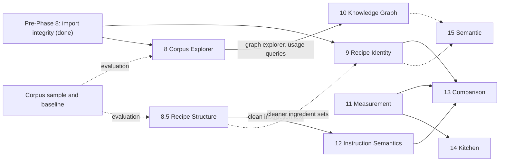

# Phase 8 (Corpus Explorer) and Phase 8.5 (Recipe Structure Intelligence)

Status (14 November 2026): every checkpoint of Phase 8 (8-A to 8-E) and Phase 8.5 (8.5-A to 8.5-E) is implemented in the working tree. Migrations `20261114000000_corpus_analytics_snapshot` and `20261114010000_structure_review` are applied to dev (backup in `~/peas-backups/peas-dev-before-phase8-migrations-20261114-0947.dump`) and replay cleanly (`db:verify-migrations`). What remains needs real data: measuring the validator's precision on the corpus sample below, and with it which patterns may be applied automatically. Each checkpoint below is a PR-sized slice with its own tests and acceptance criteria. Phases 1–7 and pre-Phase 8 import integrity are complete (see [ingredient ontology rebuild](./ingredient-ontology-rebuild.md) and [import integrity](./import-integrity.md)).

## Implemented

### 8-A: open an ingredient and inspect its usage

| # | Deliverable | How to see it |
| --- | --- | --- |
| 1 | **Usage, direct and expanded.** `getConceptUsage` counts mentions, lines, notes, and recipes for the concept itself and for the concept plus the more specific foods reached through the chosen relationship types (default IS_A and PART_OF; DERIVED_FROM and PROCESSED_FROM only when asked), over active lines of unarchived notes. Each contributing food carries its path ("part of chicken"). | `packages/database/src/repository/ontology/explorer.ts`; integration test `explorer.int.test.ts` |
| 2 | **Settled by default.** Only mentions that name the concept (AUTO_RESOLVED or VERIFIED) count; "Include mentions waiting for review" adds NEEDS_REVIEW mentions whose best candidate is the concept, and the waiting count is always shown. | Same test, "counts mentions waiting for review only when asked" |
| 3 | **Observed forms.** Each of the concept's names with how many direct mentions were written that way (the entry the resolver matched), an example line, and unused names last. | `getObservedForms` |
| 4 | **Preparation, attribute, and modifier distributions**, each row with its direct and expanded count; attributes also say how many were written in the text. | `getConceptDistributions` |
| 5 | **GraphQL.** `Concept.usage(expand, includeNeedsReview)`, `Concept.observedForms`, `Concept.distributions` as field resolvers (the existing `ConceptDetail` query is unchanged; a `ConceptParent` mapper keeps them out of the `concept` resolver). The value types are embedded in the Apollo cache, so they drop with `CONCEPT_DETAIL`. | `packages/api/src/resolvers/explorer.ts`; API integration test `explorer.int.test.ts` |
| 6 | **Concept page panel.** "Usage in the collection" below the concept card: a direct versus expanded table, contributing foods, how it's written, and preparation and attribute tables. The two switches live in the URL (`?madeFrom=1`, `?review=1`); the explorer query is preloaded by the route and switches change it in a transition, so the previous numbers stay on screen. Relationships on the card are ordered by type. | `/concepts/$id`; `packages/features/src/concepts/concept-usage.tsx` and its tests |

Deviation: the plan assumed NEEDS_REVIEW mentions carry a concept. They don't (`IngredientMention.conceptId` is set only for AUTO_RESOLVED and VERIFIED), so the review switch matches the best candidate stored in the resolution, and the status breakdown is auto-resolved, verified, and waiting for review (an UNRESOLVED mention can never count toward a concept).

### 8.5-A: block classifier and fixtures

| # | Deliverable | How to see it |
| --- | --- | --- |
| 1 | **Importer-identical segmentation with provenance.** `segmentContent(lines)` files lines exactly as `parseContentLines` in `apps/queue/src/parsers/html.ts` does and keeps each line's content index, block, and line number; `splitStoredContent` rebuilds the lines of a stored note from `Note.html`. | `packages/parser/src/v2/structure/segment-content.ts` |
| 2 | **Explainable scoring.** `blockFeatures` reads a line (leading quantity and unit from the parser, imperative cooking verbs but not participles, ambiguous verbs only before an object, compound verbs such as stir-fry, step openers, numbered steps, temperatures, durations, sentences, heading shapes, notes, yields, links); `featureSignals` turns them into weighted signals from one table (`SIGNAL_WEIGHTS`); the importer's section adds one point so ties keep its choice. | `features.ts`, `score.ts` |
| 3 | **Findings only where the evidence clearly disagrees.** `validateStructure` adds neighbor evidence for uncertain blocks (a short line opening an ingredient block, a line between ingredients, a step-like line next to steps), proposes a kind when it leads the importer's section by 2 points, and splits a heading glued to the start of a line ("For the Cumberland sauce: Combine…"). Every finding carries its signals and `STRUCTURE_CLASSIFIER_VERSION` (1.0.0). | `validate.ts` |
| 4 | **Fixtures and report.** 16 labelled notes (11 dev, 5 held-out; 149 blocks) covering colon and bare headings, all-caps headings, steps without blank lines, numbered steps, ingredients standing alone, notes, yields, glued headings, and lines that look like steps or headings but are not. `yarn workspace @peas/parser evaluate:structure` writes `fixtures/reports/structure.md`, with and without a food lexicon. | Both sets: every misfiled block found, no false positives. The fixtures were written alongside the rules, so this shows the rules match the examples, not real-world accuracy; the 8.5-B shadow run on the evaluation snapshot is the real measure. |
| 5 | **Tests.** 175 structure tests (segmentation edge cases, features, the roadmap examples, findings and their evidence, determinism under case and whitespace, every fixture block). Parser coverage stays above its floors. | `yarn workspace @peas/parser test:coverage` |

Nothing in 8.5-A touches the importer, the database, or the UI.

### 8-B: ingredient usage explorer

| # | Deliverable | How to see it |
| --- | --- | --- |
| 1 | **Every line behind a concept's usage.** `listConceptOccurrences` returns one row per counted mention (the same counting rules as usage) in reading order (note, block, line, segment, part) with the line text and the mention's span, the note and recipe, the concept it counts for and the relationship path that reached it, its status, preparations, and attributes. | `packages/database/src/repository/ontology/explorer.ts`; integration test "occurrences" |
| 2 | **Filters**: expansion and mentions waiting for review (as on the concept page), preparation, attribute (`definition:value`), source (any linked source), category (approved or inferred memberships only), and status. `getConceptOccurrenceFacets` lists the sources and categories of the counted notes for the filter menus; preparation and attribute choices come from the concept's distributions. | Same test, "filters by preparation, attribute, source, category, and status" |
| 3 | **Keyset paging** on the reading-order key, so pages neither repeat nor skip while notes are imported; a malformed cursor is a user error. | Same test, "pages with a cursor" |
| 4 | **GraphQL**: `conceptOccurrences(conceptId, filter, after, limit)` (50 by default, at most 100) returning `items`, `total`, and `nextCursor`, and `conceptOccurrenceFacets(conceptId, expand, includeNeedsReview)`. Concept ids must be UUIDs, status must be a counted status, and attributes must look like `bone:boneless`; each is a `BAD_USER_INPUT` error otherwise. | `packages/api/src/resolvers/explorer.ts`; API integration test |
| 5 | **Page**: `/concepts/$id/usage` ("Lines with chicken"), linked from the usage card ("See all 15 mentions"). Lines are grouped by note with links to the note and recipe, the mention is highlighted, and each line says how it matched ("chicken thigh (part of chicken) · Dice · Bone: Boneless"). Every filter is in the URL (`madeFrom`, `review`, `prep`, `attr`, `source`, `category`, `status`); Load more appends the next page through an Apollo merge keyed by concept, filter, and limit. Both pages share one distributions fragment, so the cache never loses fields between them. Results drop with `CONCEPT_DETAIL` and `MENTIONS`. | `packages/features/src/concepts/concept-occurrences.tsx`; `apps/web/src/routes/_authed/concepts/$id_.usage.tsx` |
| 6 | **Tests**: database, API, and feature tests, web unit tests for the link builder and the Load more merge, and an end-to-end test (concept page to its lines, filter by attribute, back) with WCAG 2.1 AA scans of both pages, passing in Chromium and WebKit. | `apps/web/tests/concepts.spec.ts` ("explores a concept's usage down to the lines behind it") |

Deviation: pages report `nextCursor` (null on the last page), like `discoveryQueue`, instead of a `pageInfo` object.

### 8.5-B: shadow mode

| # | Deliverable | How to see it |
| --- | --- | --- |
| 1 | **The importer uses the shared rules.** `parseContentLines` in `apps/queue/src/parsers/html.ts` now calls `segmentContent`, so the importer and the validator can never disagree about where a line was filed. The existing 90 HTML parser tests, which drive the real extraction, pass unchanged. | `yarn workspace @peas/queue test:run` |
| 2 | **Shadow validation on every import.** After the parse step, `runStructureShadow` validates the note (structure only, no lexicon lookups), logs `[STRUCTURE_SHADOW] <title>: 2 findings in 18 blocks (SECTION_HEADING 1, INSTRUCTION 1)`, and counts it; it never changes the import and never throws. `GET /metrics/ingredients` gains `structure`: notes, blocks, notes with findings, findings by proposal, failures, and the 25 most recent findings. | `apps/queue/src/services/note/structure-shadow.ts` and its tests |
| 3 | **Shadow report.** `yarn workspace @peas/queue structure:shadow [--dir <folder>] [--limit N] [--sample 200] [--lexicon]` validates every stored note (rebuilt from `Note.html`) or every exported HTML file under a folder and writes `packages/parser/fixtures/reports/structure-shadow.md` (totals, proposals by kind, and a review sample taken round-robin across proposal kinds in a stable order, with an empty Correct column) plus every finding as JSON lines in `apps/queue/logs/`. Read-only. | On dev: the venison note's glued sauce heading; on `apps/queue/public/files`: "Place all of the ingredients in a blender and blitz until smooth. Pour", a step filed as an ingredient |
| 4 | **Provenance check.** For stored notes the report compares the filing rebuilt from `Note.html` with the saved ingredient and instruction rows and lists notes that differ, which tells 8.5-C whether a backfill of content positions can be exact. On dev, 0 of 1 differ. | "Stored lines" section of the report |
| 5 | **Pure helpers** (`shadowNote`, `storedDrift`, `summarizeShadow`, `buildShadowReport`) live in `@peas/parser` with tests; the script only reads and writes. | `packages/parser/src/v2/structure/shadow.ts` |

Deviations: the shadow script lives in `@peas/queue` rather than `@peas/database`, because reading exported HTML needs the queue's extraction; the import-time shadow runs on structure alone (the report can add the stored lexicon with `--lexicon`).

Still open for 8.5-B: running the report on the evaluation snapshot and reviewing its sample (at least 200 findings) to measure precision per proposal kind.

Related documents:

- [Cache consistency](./cache-consistency.md): invalidation domains and the mutation effect contract every new mutation follows
- [Testing and coverage](../testing.md)

### 8-C: lexical vocabulary explorer

| # | Deliverable | How to see it |
| --- | --- | --- |
| 1 | **Where each lexicon entry is used.** Every entry on `/lexicon` links to `/lexicon/$entryId`: the entry, what it means, the revision that added (or retired) it, and every line in active notes whose stored reading used it, with the matched words marked, newest pages by Load more. Found through the lexemes' entry ids in the stored syntax (any role: foods, attributes, preparations, degrees, modifiers), after a cheap prefilter on the entry's longest word; coordinated parts list under their own word. | `listLexiconEntryOccurrences` in `packages/database/src/repository/ontology/lexicon-explorer.ts`; integration test `lexicon-explorer.int.test.ts` |
| 2 | **Newly learned names.** The lexicon has a "Newest first" order (by the revision that added each entry). | `/lexicon?newest=1` |
| 3 | **Unknown and ambiguous expressions, by source.** `/lexicon/unknown` lists open unknown-food, unknown-word, and ambiguous review cards, most notes first, each linking to its card; the source filter counts only evidence from that source's notes, so a site's or a book's vocabulary stands out. | `listUnknownExpressions`, `getUnknownExpressionSources` |
| 4 | **GraphQL**: `lexiconEntry(id)` with `occurrences(after, limit)`, `lexicon(newestFirst)`, `unknownExpressions(type, sourceId, page)`, `unknownExpressionSources`; curator-only like the lexicon. | `packages/api/src/resolvers/lexicon-explorer.ts` |

### 8-D: corpus analytics

| # | Deliverable | How to see it |
| --- | --- | --- |
| 1 | **Corpus-wide usage with direct and expanded counts kept apart.** `getCorpusAnalytics` returns settled mentions, foods mentioned, approved foods never seen, rare foods (one or two notes), the most-used foods by direct mentions and by mentions including kinds and parts (mentions are grouped by food first, then rolled up through the IS_A / PART_OF closure), and corpus-wide preparation and attribute distributions. | `packages/database/src/repository/ontology/explorer.ts`; integration test |
| 2 | **Served from a snapshot.** `CorpusAnalyticsSnapshot` stores the analytics; the dashboard reads the newest one, a snapshot older than 15 minutes or taken before the current lexicon revision is shown (marked "refreshing") while one refresh runs in the background, and every health snapshot (daily, after each reinterpretation or reparse run, and on request) takes one too. Clearing imported data deletes them. | `analytics-snapshots.ts`; dashboard "Foods in the collection" with "Updated …" |
| 3 | **Dashboard section** below the overview cards: totals, "With kinds and parts" (expanded mentions with the direct count beside each), rare foods, preparations, and descriptions. The direct ranking stays in the existing "Most-used ingredients" card, so nothing is shown twice. | `/`; `packages/features/src/dashboard/components/corpus-analytics.tsx` |
| 4 | **Measured on a synthetic corpus the size of the collection** (3,000 foods in a ten-way tree, 60,000 notes, 600,000 lines and mentions, 10,000 recipes; `yarn workspace @peas/database db:benchmark:explorer --seed` against a database named `*bench*`), median of five runs: corpus analytics 839 ms (2,335 ms before grouping by note ahead of counting; hence the snapshot), usage of a mid-tree food 194 ms, observed forms 26 ms, distributions of the root 284 ms, first occurrence page of the root 268 ms, occurrence facets 29 ms, a lexicon entry's occurrences 439 ms. Over the 300 ms target: usage of a single root covering every food (2,458 ms, a shape the real ontology does not have) and occurrences filtered by preparation on a heavy food (785 ms). | `packages/database/scripts/benchmark-explorer.ts` |

Deviation: analytics refresh through a snapshot table rather than a materialized view or a per-concept projection: the payload is small, Prisma handles it natively, and the existing health snapshot triggers cover freshness. `corpusAnalytics` drops with `DASHBOARD_STATS` and `CORPUS_HEALTH` instead of a new domain.

### 8-E: relationship graph

| # | Deliverable | How to see it |
| --- | --- | --- |
| 1 | **Neighborhood, never the whole graph.** `getConceptNeighborhood` walks breadth-first from a food through the chosen relationship types, up (more general), down (more specific), or both, one query per step, at most three steps and 150 foods (`truncated` says when the limit cut it short); each food has its level (signed distance) and direct mention count, and each relationship its status and the decision that added it (type, revision, reviewer, date). | `packages/database/src/repository/ontology/graph.ts`; integration test "neighborhood" |
| 2 | **GraphQL**: `conceptGraph(conceptId, depth, types, direction)`; depth outside 1 to 3 is a user error. | `packages/api/src/resolvers/explorer.ts` |
| 3 | **Graph page** `/concepts/$id/graph`, linked from the concept page ("Explore relationships"): a layered SVG (more general foods above, more specific below; line style per relationship type, proposed ones faded, labels while there are 30 or fewer edges), switches for relationship types, steps, and direction kept in the URL, and the same content as lists of foods and relationships with their evidence for keyboard and screen reader users. Clicking a food (or its link in the list) recenters the graph on it, which is how neighbors are expanded. | `packages/features/src/concepts/concept-graph.tsx`; end-to-end test "explores a concept's relationship graph and the corpus analytics" |

### 8.5-C: provenance and proposals

| # | Deliverable | How to see it |
| --- | --- | --- |
| 1 | **Schema**: `ParsedIngredientLine` and `ParsedInstructionLine` gain `contentIndex` (position in the extracted content), `elementTag` (the en-note child element, for new imports), and `lineKind` (`LineKind`: INGREDIENT, INSTRUCTION, SECTION_HEADING, NOTE, OTHER); `StructureProposal` stores each finding keyed by note, position, and text hash, with the proposal and signals (Zod-validated), its pattern, the classifier version, and the decision with every effect it wrote. | Migration `20261114010000_structure_review` |
| 2 | **At import**, the save step calls `validateStoredNote`: it records positions (and element tags) for the new lines, stores proposals, and never fails the import. | `apps/queue/src/services/note/actions/save-note/service.ts` |
| 3 | **Backfill and reclassification**: `yarn workspace @peas/database db:backfill:structure [--after <noteId>]` validates every stored note, resumable and idempotent; decided proposals are never touched, and a rerun after a classifier change refreshes open proposals and supersedes ones no longer raised. On dev: 1 note, 1 proposal (the venison note's glued sauce heading). | `packages/database/scripts/backfill-structure.ts` |
| 4 | **Re-imports keep decisions.** When a note's content hash matches a note already reviewed, its decisions are applied again to the same lines, recorded as the original reviewer's. | `carryOverStructureDecisions`; integration test "applies an earlier decision again …" |

### 8.5-D: structure review

| # | Deliverable | How to see it |
| --- | --- | --- |
| 1 | **Decisions with exact undo.** Approve, reject, or change to another kind, each in one transaction with every row recorded: a heading, note, or other text becomes an inactive line of that kind kept in place (out of mentions, counts, categories, and hashes, like Mark as noise); a line moved to the other list leaves its original row inactive and adds a row there (a new ingredient is parsed and resolved immediately; instructions are reordered by content position); a split keeps the text after the heading on the line, adds the heading row before it, and re-reads the line. Changing a line to the kind it already has is a rejection. Repeating a decision does nothing; a different one needs an undo. | `decideStructureProposal`, `undoStructureDecision` in `packages/database/src/repository/structure.ts`; integration tests for every transition and its undo |
| 2 | **Structure tab** (`/teach/structure`, in the Knowledge tabs): each proposal with the two lines before and after it, where the importer filed it, the proposal (split parts quoted), the strongest evidence, and Approve, Not this, Change to, or Undo; To review and Decided lists; a pattern filter with "Approve all N" after a confirmation. | `packages/features/src/teach/structure-review.tsx`; end-to-end test `structure.spec.ts` with a WCAG 2.1 AA scan |
| 3 | **Note and recipe pages** show a filed heading as a subheading in its ingredient or instruction list. | `SectionHeadingItem` |
| 4 | **GraphQL**: `structureProposals`, `structureProposal`, `structureCounts`, `structurePatterns`; `decideStructureProposal`, `undoStructureDecision`, `decideStructurePattern`; `IngredientLine.lineKind`, `InstructionLine.lineKind`. A new `STRUCTURE_REVIEW` invalidation domain; decisions also invalidate the note and recipe pages, mentions, concept details, categories, the dashboard, and corpus health. Curator-only. | `packages/api/src/resolvers/structure.ts`; API integration test `structure.int.test.ts` |

Deviation: a split whose text after the heading belongs in the other list (a heading glued to a step filed among the ingredients) is refused with a message asking for a single kind instead.

### 8.5-E: learning from corrections

| # | Deliverable | How to see it |
| --- | --- | --- |
| 1 | **Patterns.** Every proposal carries a pattern (the proposal and its strongest signal, such as `SECTION_HEADING:COLON_HEADING`). `getStructurePatterns` reports, per pattern, open, approved, rejected, and changed counts, notes, precision (approved over decided), its scope (GENERAL across sources, SOURCE_SPECIFIC when 80% of decisions come from one primary source, ONE_OFF for a single note, UNDECIDED under three decisions), and whether it may be applied automatically (98% precision over at least 50 decisions). | Patterns table on the Structure tab |
| 2 | **Targeted reclassification**: `yarn workspace @peas/database db:reclassify:structure --list` prints each pattern's numbers; `--pattern <key> --user <username>` approves every open proposal of a pattern that has earned it (refused otherwise), one transaction per line, each undoable. | `packages/database/scripts/reclassify-structure.ts` |

No pattern applies itself during import: automatic application stays an explicit command until real precision numbers exist.

## Corpus readiness

The dev database holds 1 note, 14 ingredient lines, 7 instruction lines, 14 mentions, 33 concepts, and 22 relationships (13 November 2026), and `apps/queue/public/files` holds one exported HTML file. Everything below must work on that near-empty corpus and on partial snapshots, but the evaluation work (analytics query plans, the 8.5 shadow run, precision and recall) needs real data.

Before checkpoints 8-D and 8.5-B are evaluated, import a representative sample of at least 500 notes from several notebooks and sources, take a `pg_dump`, and record it as the Phase 8 evaluation snapshot (note ids and `CorpusHealthSnapshot` id). The existing baseline tooling already covers most of the preliminary milestone: `corpusHealth`, `corpusHealthTrends`, `GET /metrics/ingredients`, `db:evaluate:resolution`, and `reparse:dry-run`. The gaps are a block-structure baseline (8.5-A and 8.5-B produce it) and query-latency numbers on the sample (8-D records them).

## Repository gap analysis

### Phase 8

| Roadmap item | Already exists | Extend | Missing |
| --- | --- | --- | --- |
| 8.1 Concept explorer | `/concepts/$id` with names by kind, parents and children labelled by type ("is a kind of", "is part of", "is made from", "is processed from"), attributes, effective classifications with inherited ones marked, tags, substitutions, 10 example mentions, decisions with revert (`getConceptDetail`, `getConceptMentions`, `getConceptDecisions`) | Group relationships by type on the page; link example mentions to recipes as well as notes | Usage statistics (direct and expanded), observed forms (mention texts grouped by normalized form), preparation and attribute distributions, resolution status breakdown |
| 8.2 Ingredient usage | `recipes(conceptId, exactConcept)` expands IS_A and PART_OF through `conceptIdsForSearch`; categories and sources live on the note | Let the caller choose which relationship types to expand | Occurrence list (one row per mention, with the line text and how it matched), filters by preparation, attribute, source, category, and resolution status, cursor paging |
| 8.3 Lexical vocabulary | `/lexicon` lists every entry with role, kind, status, and target; `UNKNOWN_FOOD_PHRASE` and `UNKNOWN_MODIFIER` discoveries with evidence; `findMentionsByText` (trigram index) | Add occurrences to lexicon rows; filter unknown phrases by source | Occurrences per entry, newly observed aliases (entries added in the last N revisions, with mention counts), expressions per source |
| 8.4 Corpus analytics | Dashboard top concepts (8, direct line counts); `/teach/health` coverage over time, unresolved share by parser version, decisions per week, top unknown and ambiguous phrases | Dashboard and health tab sections | Direct versus expanded counts, rare concepts, preparation and attribute distributions |
| 8.5 Relationship graph | `getAncestors` and `getDescendants` (recursive CTE, depth-capped), relationship rows carry `status` and `decisionId` | | Neighborhood query (nodes and edges to a depth, filtered by type), interactive graph with a table alternative, edge evidence |

### Phase 8.5

| Roadmap item | Already exists | Extend | Missing |
| --- | --- | --- | --- |
| 8.5.1 DOM extraction | `parseHTMLContent` in `apps/queue/src/parsers/html.ts`: the text of each `en-note` child after the `h1`; a non-empty line between two blank lines (at least 10 characters, not the first line) is an instruction, runs of lines are ingredient blocks | Emit each line's content index and element tag alongside today's output | A validation stage after extraction |
| 8.5.2 Provenance | `Note.html` stores the extracted lines joined by newlines (blank lines kept), so content positions can be rebuilt; ingredient lines keep `(blockIndex, lineIndex)`, instructions `lineIndex` | Store `contentIndex` (and the element tag for new imports) on both line tables | Assigned versus proposed section, neighboring headings, review status, correction history |
| 8.5.3 Parser evidence | `processIngredientLine` (quantity, units, lexemes, unknown spans, resolution); `structuralIssue` flags `HEADING` lines ("For the glaze:") and records them as `STRUCTURAL_PATTERN` discoveries | Reuse the parse result as classifier signals | Block classifier |
| 8.5.4 Misplaced instructions | `INSTRUCTION` lexicon role (for "divided", "to taste"), the preparation vocabulary (participles such as "roasted") | | Cooking verb list, imperative, temperature, duration, and sentence signals |
| 8.5.5 Headings | `HEADING` structural reason (colon-terminated lines without a quantity) | Recognize "For the sauce" without a colon, "Garnish", "To serve", all-caps short lines | Heading as a stored line kind that keeps section structure |
| 8.5.6 Context | | | Neighbor-aware scoring |
| 8.5.7 Review | Teach Peas queue, focused card, keyboard shortcuts, `ConfirmDialog`, undoable decisions with recorded effects (the duplicate-resolution pattern) | Add a structure tab and card | Proposal model, approve, reject, and change actions, group actions |
| 8.5.8 Learning | `structureSignature` groups lines by shape; sources are structured per note | | Correction aggregation by pattern and source, targeted reclassification |
| 8.5.9 Shadow mode | `reparse:dry-run` report pattern (read-only, writes a Markdown report) | Same pattern for structure | Shadow run, disagreement sample, metrics |

## Dependencies

- **Hard prerequisites.** Phase 8 needs nothing new: it reads mentions, concepts, relationships, sources, and categories that exist. Phase 8.5 needs nothing new to build; its evaluation needs the corpus sample.
- **Independent work.** 8 and 8.5 share no code paths beyond the Teach Peas shell and can proceed in parallel. 8.5-A (pure classifier) has no database or UI dependency at all.
- **Downstream.** Phase 10 extends the 8-E graph with statistical edges; Phase 12 wants instructions that 8.5 has cleaned; Phase 9's ingredient-set fingerprints are more accurate once headings and instructions stop being stored as ingredient lines.
- **Migrations.** Phase 8 needs none until 8-D shows a measured need for a projection table. Phase 8.5 adds columns and one table in 8.5-C (expand only; nothing is dropped).
- **Backfills.** 8.5-C rebuilds `contentIndex` for stored notes from `Note.html`; resumable and idempotent like `backfill:mentions`.
- **Cache.** Phase 8 adds read-only queries that live in existing domains plus one new `CORPUS_ANALYTICS` domain; 8.5 adds a `STRUCTURE_REVIEW` domain and makes structure decisions invalidate `NOTE_DETAIL`, `RECIPE_DETAIL`, `MENTIONS`, `CORPUS_HEALTH`, and `CATEGORIES`.

## Phase 8 plan

### Outcomes

A user opens a food, sees how often it appears directly and through more specific foods, the ways it is written, how it is prepared, which relationships define it, and every recipe line that supports it, then follows those relationships in a graph.

### Counting semantics

Every statistic says which of these it is, and the UI labels them:

- **Direct**: mentions whose `conceptId` is the concept.
- **Expanded**: mentions of the concept or of a concept reached by walking **down** chosen relationship types. The default expansion is IS_A and PART_OF ("kinds and parts"), matching `conceptIdsForSearch` and category traversal; DERIVED_FROM and PROCESSED_FROM ("made from") are opt-in and never part of the default. Each expanded row records the path that reached it (`chicken thigh → part of → chicken`).
- **Settled only**: resolution coverage counts all statuses; usage counts only `AUTO_RESOLVED` and `VERIFIED` by default, with a toggle to include `NEEDS_REVIEW`, so an unreviewed guess never inflates usage.
- Lines are active lines of unarchived notes, matching the dashboard; recipes are counted through `Recipe.noteId`.

### Database and domain services (`packages/database/src/repository/ontology/explorer.ts`)

| Function | Returns | Query shape |
| --- | --- | --- |
| `getConceptUsage(conceptId, { expand, includeNeedsReview })` | Direct and expanded counts of mentions, lines, notes, recipes; counts by resolution status; contributing descendants with their own counts and paths | One recursive walk for the descendants (reuses `walk`), then one grouped count over `IngredientMention` joined to active lines |
| `getObservedForms(conceptId, { limit })` | Mention `normalizedText` values with counts, first and last seen, and whether an active lexicon entry has that match key (lexical form versus phrase seen only in context) | `GROUP BY normalizedText` on the concept index |
| `getConceptDistributions(conceptId, { expand })` | Preparation keys with degree breakdown, attribute values by dimension, modifiers | Grouped counts over `MentionPreparation`, `MentionAttribute`, `MentionModifier` |
| `listConceptOccurrences(conceptId, filters, cursor)` | One row per mention: line text, mention span, note and recipe ids and titles, matched-by path, preparations, attributes, resolution status, primary source | Keyset paging on `(noteId, parsedLineId, mentionId)`; filters are joins (`NoteSource`, `NoteCategory` with state `APPROVED` or `INFERRED`, `MentionPreparation`, `MentionAttribute`) |
| `getLexiconEntryOccurrences(entryId, cursor)` | Mentions whose syntax used the entry | FOOD entries: mentions whose syntax lexemes carry the entry id; other roles: `MentionAttribute.lexiconEntryId`, or a match-key prefilter through the trigram index and a syntax check |
| `getCorpusAnalytics({ limit })` | Top concepts direct and expanded, rare concepts (settled mentions in one or two notes), preparation and attribute distributions corpus-wide | Group mentions by concept first, then roll up through a hierarchy closure computed in the same CTE (concepts number in the thousands; mentions in the hundreds of thousands) |
| `getConceptNeighborhood(conceptId, { depth ≤ 3, types, direction, limit ≤ 200 })` | Nodes (id, name, status, direct mention count) and edges (type, status, decision id, revision, decided by and when) | Bidirectional recursive walk with the depth and node caps enforced in SQL; `truncated` flag when the cap is hit |

All are read-only, take the `DbClient` like the rest of the repository, and are covered by integration tests against `TEST_DATABASE_URL`.

### GraphQL

- `Concept.usage(expand: [FoodRelationshipType!], includeNeedsReview: Boolean): ConceptUsage!`, `Concept.observedForms(limit: Int)`, `Concept.distributions(expand: …)`; field resolvers so the existing `ConceptDetail` query is unchanged and the page asks for the new fields separately.
- `conceptOccurrences(conceptId: ID!, filter: ConceptOccurrenceFilter, after: String, limit: Int): ConceptOccurrencePage!` with `pageInfo { endCursor hasNextPage }`.
- `LexiconEntry.occurrences(after, limit)` and `newlyObservedEntries(sinceRevision)`.
- `corpusAnalytics: CorpusAnalytics!` (signed-in users; same visibility as the dashboard).
- `conceptGraph(conceptId: ID!, depth: Int, types: [FoodRelationshipType!], direction: GraphDirection): ConceptGraph!`.
- No mutations. Resolvers call the repository functions only (business logic stays in `@peas/database`).

### Caching

- Usage, forms, distributions, occurrences, and the graph live under `CONCEPT_DETAIL` (they change exactly when the concept page would). The occurrence list also drops with `MENTIONS`.
- `corpusAnalytics` gets a new `CORPUS_ANALYTICS` domain, invalidated by every Teach Peas decision, a newer lexicon revision, and job completion (the same triggers as `CORPUS_HEALTH`).
- Computed on request first. A projection table (`ConceptUsageStat`, keyed by concept and lexicon revision, refreshed after reinterpretation runs) is added only if 8-D measures the analytics query above 300 ms on the sample.

### UI

- `/concepts/$id`: a Usage card (direct and expanded counts side by side with the expansion toggle, contributing descendants with their paths), Observed forms, Preparations, and Attributes cards, relationships grouped by type, and "See all N occurrences" linking to the usage view. Viewable by everyone, like the concept page.
- `/concepts/$id/usage`: the occurrence explorer, with filters in URL search params (`expand`, `prep`, `attr`, `source`, `category`, `status`), rows grouped by recipe or note, each linking to the note line, and the matched-by path for expanded rows. Pages of 50 with "Load more"; virtualization only if pages grow past a few hundred rows (still deferred repo-wide).
- `/lexicon`: an Occurrences disclosure per row and a "Recently added" filter.
- `/` (dashboard) and `/teach/health`: an Analytics section with direct and expanded top concepts, rare concepts, and preparation and attribute distributions as plain SVG bar charts with data tables, matching the Health tab.
- Graph: a section on the concept page (and `/concepts/$id/graph` full width) rendering the neighborhood as a layered SVG (ancestors above, descendants below, edges labelled by type and dashed when proposed), with relationship-type checkboxes, a depth selector (1 to 3), click or Enter to expand a node, a link to each node's page, an edge popover with its decision and revision, and the same data as a nested list for keyboard and screen reader users. No graph library; layout is computed from depth, so it stays deterministic and testable.

### Tests and acceptance

- Database integration: direct versus expanded counts on the starter foods (chicken thighs count toward chicken only when PART_OF is expanded; chicken stock counts only with DERIVED_FROM), settled-only default, archived notes excluded, occurrence paging stable across inserts, neighborhood caps and `truncated`.
- API: field resolvers, argument validation (depth and limit caps), visibility.
- Features: each new card, the filter bar, the graph's table alternative.
- End to end: open chicken, see usage, open occurrences filtered by preparation, follow a graph node to its page; axe WCAG 2.1 AA on the usage view and graph at desktop and mobile widths.
- Performance: `EXPLAIN ANALYZE` of `getCorpusAnalytics` and `listConceptOccurrences` on the evaluation snapshot recorded in this document; each under 300 ms or a projection is added.
- **Definition of done**: from `/ingredients` a user opens a food, inspects its relationships and observed forms, and reaches every recipe line that supports it.

### Deferred

Statistical associations in the graph (Phase 10), similarity between recipes (Phase 9), ontology coverage per source over time beyond what health snapshots already record, materialized views unless measured.

## Phase 8.5 plan

### Outcomes

Headings, instructions, and notes that the DOM rules misfile are detected without slowing correctly classified recipes, shown to a reviewer with their surroundings and evidence, and corrected in a way that survives reprocessing and reimport. The importer keeps classifying first; the validator only raises exceptions.

### Classifier (`packages/parser/src/v2/structure/`, pure)

- `segmentContent(lines)` reproduces `parseContentLines` exactly (a regression test runs both on the same inputs) and adds provenance: `contentIndex`, `blockIndex` and `lineIndex` or instruction index, the assigned section, and the previous and next non-empty blocks. The queue then calls it instead of its private copy, so the importer and the validator can never disagree about what was extracted.
- `blockFeatures` and `featureSignals` (with `classifyLine` for a single line) return a score per kind (`INGREDIENT`, `INSTRUCTION`, `SECTION_HEADING`, `NOTE`, `OTHER`) and the signals behind it:

| Signal | Points toward | Notes |
| --- | --- | --- |
| Leading quantity and unit parsed by `processIngredientLine`, food lexeme or unknown phrase after it, short line, no sentence-final period | Ingredient | "2 tbsp olive oil" |
| No quantity, but an `UNSPECIFIED` amount ("to taste") or a known food followed by `and` and another food | Ingredient | "Salt and pepper to taste" |
| Imperative cooking verb at the start ("Add", "Stir", "Bake", "Preheat", "Simmer", "Refrigerate"), from a curated verb list that is separate from the preparation vocabulary | Instruction | "Roasted peppers" is a participle and does not count; "Roast the peppers" does |
| Temperature ("400 degrees", "200°C"), a duration attached to a verb ("for 20 minutes", "until golden"), sequencing words ("then", "meanwhile", "once"), several sentences | Instruction | A quantity and unit alone never prove an ingredient: "Cook for 20 minutes" parses a quantity but scores as an instruction |
| "For the X" with or without a colon, a short colon-terminated line without a quantity (`structuralIssue` HEADING), "Garnish", "To serve", "Topping", short all-caps lines | Section heading | Kept as structure, never as a food |
| Parenthetical or advisory text ("Note:", "Tip:", "Can be made ahead") | Note | |
| Context: a block between two ingredient lines with no verb leans heading; a long single line inside an ingredient block with a verb leans instruction | Adjusts the above | Deterministic rules, no sequence model unless these demonstrably fail |

- `validateStructure(blocks, resolverContext)` returns `StructureFinding[]` only where the best kind differs from the assigned one by at least a margin, plus "split" findings for a heading glued to an instruction ("For the Cumberland sauce: Combine…" proposes a heading followed by an instruction). `STRUCTURE_CLASSIFIER_VERSION` is stamped on every finding.
- Fast path: a block the parser reads cleanly as an ingredient (settled food, quantity, no verb) or a long multi-sentence instruction with a leading verb is accepted with no further work, so the validator adds a parse per ingredient line the importer already performs and nothing else.

### Fixtures and evaluation

- `packages/parser/fixtures/structure/notes.dev.json`: hand-labelled note content (the roadmap's examples, the stored venison note, and, once imported, lines drawn from the sample), `notes.holdout.json` kept out of tuning.
- `yarn workspace @peas/parser evaluate:structure` writes `fixtures/reports/structure.md`: precision and recall for ingredients and instructions, heading accuracy, the confusion matrix, and every disagreement.

### Shadow mode

- `yarn workspace @peas/queue structure:shadow [--dir <html directory>] [--limit N]` reads stored notes (rebuilding blocks from `Note.html`) or raw exported HTML, runs the validator, and writes `fixtures/reports/structure-shadow.md` plus a JSONL of findings for sampling. Read-only.
- The queue's parse step logs `[STRUCTURE_SHADOW]` counts per note (findings by kind) and adds them to `GET /metrics/ingredients`; accepted data is untouched.
- Exit criterion for leaving shadow mode: on a reviewed sample of at least 200 findings, per-pattern precision is measured; only patterns at 98% or better may later auto-apply, and only after 8.5-E.

### Persistence (8.5-C)

- `ParsedIngredientLine.contentIndex Int?` and `ParsedInstructionLine.contentIndex Int?` (plus `elementTag String?` on new imports), filled at import and backfilled from `Note.html`.
- `ParsedIngredientLine.lineKind` (`INGREDIENT` default, `SECTION_HEADING`, `NOTE`): a heading stays in its block, so the section structure is kept, but it is excluded from mentions, discoveries, ingredient counts, duplicate content hashes, and categories (the same exclusions as inactive lines).
- `StructureProposal`: `noteId`, `contentIndex`, `text`, `textHash`, `assignedKind`, `proposedKind`, optional split (`splitAt`), `score`, `evidence` (Zod-validated signals), `classifierVersion`, `status` (`OPEN`, `APPROVED`, `REJECTED`, `CHANGED`, `SUPERSEDED`), `decidedKind`, `decidedBy`, `decidedAt`, and `effects` (every row written, so undo reverses exactly that). Unique on `(noteId, contentIndex, textHash)`, so a reimport of the same content finds the existing decision and reapplies it instead of asking again.
- Only findings are stored, never every block, so correctly classified recipes cost nothing.

### Review (8.5-D)

- A Structure tab in the Knowledge section listing open proposals by priority (score times the number of notes sharing the pattern), and a card showing the original line with two lines of context on each side, the importer's section, the proposed one, the signals, and Approve, Reject, and Change to (ingredient, instruction, heading, note). A pattern header offers "Apply to all N like this" for proposals with the same signature.
- Applying a decision in one transaction: ingredient to instruction deactivates the ingredient line (keeping its mentions for provenance, as Mark as noise does) and inserts an instruction at the right position; instruction to ingredient inserts an ingredient line and schedules its parse; to heading sets `lineKind`; a split writes both. Effects are recorded; Undo reverses them. Verified mentions are never deleted.
- Durability: decisions are keyed by content, not by row id, so reparsing, reinterpretation, and reimport reapply them; a changed line text supersedes the proposal and the classifier runs again.

### Learning (8.5-E)

- Aggregate decided proposals by pattern (block signature such as `HEADING:"for the" W` or `INSTRUCTION:verb+duration`), by primary source host, and by note, and report which are general rules, source-specific habits, or one-offs.
- A pattern with consistent approvals and the measured precision becomes an auto-apply rule (stored with its version and the decisions that justified it); `reclassify:structure --pattern <id>` reruns it on stored notes as a resumable, idempotent job on the existing reinterpret queue.

### Tests and acceptance

- Parser: every roadmap example, the venison note, metamorphic tests (case, trailing period, extra whitespace change nothing), `segmentContent` parity with the queue's current extraction.
- Database integration: backfill idempotency, proposal upsert keyed by content, each decision and its undo, reimport reapplies a decision, headings excluded from mentions and counts.
- End to end: correct "For the sauce:" imported as an ingredient into a heading, see the note page show it as a heading, undo; axe on the Structure card.
- **Definition of done**: on the evaluation snapshot, common misclassifications are detected, corrections are durable, and the reviewed false-positive rate of shown proposals is recorded and acceptable; no correctly classified recipe changes.

### Deferred

Website scraping, JSON-LD, Schema.org, microdata, RDFa, OCR, and any LLM classifier (future import sources), structured cooking operations (Phase 12).

## Shared infrastructure

- **Keyset paging** (`after`, `limit`, `nextCursor`) introduced by `conceptOccurrences` and reused by lexicon occurrences and the structure queue; existing page-number lists stay as they are.
- **Read-only evidence rows**: occurrences, lexicon occurrences, and structure context all render a line with its note, recipe, and span through one `EvidenceLine` component in `packages/features/src/shared`.
- **Reports**: `evaluate:structure` and `structure:shadow` follow `reparse:dry-run` (Markdown in `fixtures/reports`, nothing written to the database).
- **Undoable decisions with recorded effects**: structure decisions reuse the duplicate-resolution pattern (`effects` JSON, idempotent repeat, undo newest first).
- **Background work**: reclassification runs on the `reinterpret` queue with deterministic job ids, like reparse runs, and closes with a health snapshot.
- **Plain SVG charts with data tables** from the Health tab for analytics and the graph.

## Checkpoints

Each is one PR, leaves the app working, and lands with its tests.

| # | Slice | Contents | Acceptance |
| --- | --- | --- | --- |
| 8-A | Open an ingredient and inspect its usage | `getConceptUsage`, `getObservedForms`, `getConceptDistributions`; `Concept.usage`, `observedForms`, `distributions`; Usage, Observed forms, Preparations, Attributes cards; relationships grouped by type | Direct and expanded counts are labelled and correct on the starter foods; integration, API, and feature tests |
| 8-B | Ingredient usage explorer | `listConceptOccurrences`, `conceptOccurrences`, `/concepts/$id/usage` with URL filters | Filters by preparation, attribute, source, category, status; stable paging; e2e and axe |
| 8-C | Lexical occurrences (done) | `lexiconEntry.occurrences`, newest-first lexicon, unknown expressions by source | Every lexicon row reaches its occurrences |
| 8-D | Corpus analytics | `getCorpusAnalytics`, `CORPUS_ANALYTICS` domain, dashboard and health sections, query plans on the sample | Under 300 ms on the evaluation snapshot, or a projection table with a refresh job |
| 8-E | Relationship graph | `getConceptNeighborhood`, `conceptGraph`, SVG explorer with table alternative | Depth and type filters, node expansion, edge evidence, keyboard navigation, axe |
| 8.5-A | Block classifier and fixtures | `segmentContent`, `blockFeatures`, `validateStructure`, dev and held-out fixtures, `evaluate:structure` | All roadmap examples classified; report shows per-kind precision and recall |
| 8.5-B | Shadow mode | Queue uses `segmentContent` (parity test), `[STRUCTURE_SHADOW]` metrics, `structure:shadow` report | Import output unchanged; disagreement sample from the evaluation snapshot reviewed |
| 8.5-C | Provenance and proposals | Migration (`contentIndex`, `elementTag`, `lineKind`, `StructureProposal`), backfill, proposals written at import | Backfill idempotent; headings excluded from mentions, counts, hashes, categories |
| 8.5-D | Correct a heading imported as an ingredient | Structure tab and card, decisions with undo, group apply, `STRUCTURE_REVIEW` domain | Decision survives reparse and reimport; e2e and axe |
| 8.5-E | Learn from corrections | Pattern aggregation, auto-apply rules gated by precision, `reclassify:structure` job | Only patterns at 98% precision or better auto-apply |

## Open decisions

1. **Where the classifier lives.** Proposed: `@peas/parser` (pure, next to `structuralIssue`, usable by the queue and scripts without a database). The alternative is the queue, which would keep the parser package ingredient-only.
2. **Headings as a line kind or a separate table.** Proposed: `lineKind` on `ParsedIngredientLine`, so headings keep their block position with no join. A `RecipeSection` table would model sections explicitly but is more than 8.5 needs.
3. **Graph rendering.** Proposed: deterministic layered SVG without a library. A force layout (d3-force or similar) looks richer but is harder to test and to make accessible.
4. **Usage counting default.** Proposed: settled mentions only (`AUTO_RESOLVED`, `VERIFIED`). Counting `NEEDS_REVIEW` too would show more but inflates usage with guesses.
5. **Evaluation sample.** Which notebooks and how many notes to import for the Phase 8 evaluation snapshot.
