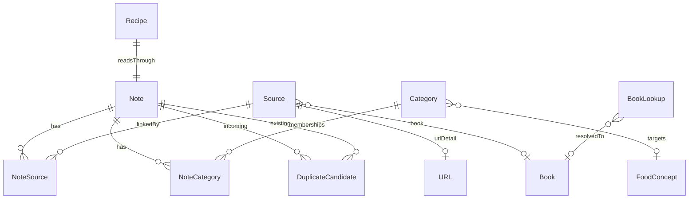

# Import integrity: sources, duplicates, and categories

Status (13 November 2026): implemented (Pre-Phase 8, milestones M0 to M6). Migrations `20261113080000_import_integrity_expand` and `20261113090000_import_integrity_contract`.

Imported recipes now have structured, deduplicated sources (URLs checked for reachability, book titles matched to Open Library), explicit and reversible duplicate decisions, and categories that are either chosen by hand or inferred from the food ontology. Sources and categories belong to the note; a recipe reads them through its note.

## Data model



| Model | Holds |
| --- | --- |
| `Source` | One identity per URL, book, or other text: `kind` (`URL`, `BOOK`, `OTHER`) and a unique `canonicalKey` (`url:<normalized>`, `book:<bookId>`, `text:<normalized text>`, or `legacy:<id>` for rows that had none) |
| `URL` | One per URL source: the original URL, its normalized form (unique), and the last check (`checkStatus`, `lastCheckedAt`, `lastSuccessfulVisitAt`, `lastHttpStatus`, `lastFailureReason`, `lastFinalUrl`, `canonicalUrl`, `consecutiveFailures`) |
| `Book` | A work: title, subtitle, authors, publisher, year, Open Library work key and cover, `matchStatus` (`UNMATCHED`, `AUTO_MATCHED`, `CONFIRMED`, `MANUAL`). ISBNs and the edition key are set only with evidence for that edition |
| `BookLookup` | One lookup per distinct source text (`queryKey` is the normalized text): ranked candidates with evidence, status, attempts, and the matched book |
| `NoteSource` | A note's link to a source: the source string as it appeared on that note, `isPrimary` (at most one per note, a partial unique index), and `origin` (`EVERNOTE_IMPORT`, `DUPLICATE_MERGE`, `MANUAL`) |
| `Category` | `MANUAL` or `CONCEPT` (a target food plus the relationship types to follow, `traversal`), a unique `slug`, and `ruleVersion` |
| `NoteCategory` | A note's membership: `state` (`INFERRED`, `APPROVED`, `EXCLUDED`), `origin`, and for inferred rows the evidence path |
| `DuplicateCandidate` | A possible duplicate pair: `kind` (`EXACT`, `LIKELY`, `POSSIBLE`), confidence, signals, status, and once decided the resolution and every effect it wrote |
| `Note` (new columns) | `rawHtmlHash`, `contentHash`, `titleSimHashBands`, and soft deletion: `archivedAt`, `archivedReason`, `supersededById` |

Design choices:

- **Sources and categories live on the note.** Every recipe is a 1:1 promotion of a note, and notes need sources and categories before promotion. Recipes used to hold copies that drifted; now `getRecipeDetail` and the recipe list read the note's rows.
- **Links carry what differs per note; sources are shared.** The primary flag and the original string sit on `NoteSource`, so the Apollo cache can key `Source` by id without mixing up notes.
- **No Book/BookEdition split yet.** A `Book` is a work identified by its Open Library work key. An ambiguous title never gets an arbitrary edition's ISBN.
- **Archiving, not deleting.** A superseded duplicate keeps its lines, mentions, sources, and categories; lists, counts, category inference, and duplicate detection skip archived notes.

## Sources

### Import

`PROCESS_SOURCE` (inside `SCHEDULE_ALL_FOLLOWUP_TASKS`) calls `attachImportedSource(noteId, rawSource)`:

- An http(s) URL is normalized and becomes (or reuses) a URL source; a reachability check is queued unless the URL was checked in the last 30 days.
- Any other text becomes a text source (`kind OTHER`) with one shared `BookLookup`; once that text has matched a book, new notes link straight to the book's source.
- The note's primary source is re-chosen (below). Failures are logged and never fail the import; the raw string stays on `EvernoteMetadata.source`.

### URL normalization

`normalizeUrl` (in `@peas/database`) is deliberately conservative: it lowercases the scheme and host, drops default ports, the fragment, credentials, and known tracking parameters (`utm_*`, `fbclid`, `gclid`, `dclid`, `msclkid`, `mc_cid`, `mc_eid`, `igshid`, `_ga`, `_gl`, `yclid`), and turns an empty path into `/`. The scheme, `www.`, trailing slashes, parameter order, and the encoding of kept parameters are untouched. Redirect targets (`lastFinalUrl`) and canonical URLs are stored separately; duplicate detection compares them but they never change a URL's identity.

### Reachability checks

The `source` queue's `SourceWorker` runs `CHECK_URL` jobs (four at a time, at most five per second; job id `url-check-<urlId>`):

- HEAD first, GET when the server answers 400, 403, 405, or 501, or the HEAD request fails. A GET reads at most 64 KB, only for HTML, to find `<link rel="canonical">`, then aborts.
- Redirects are followed by hand (at most five) and every hop is validated again. The whole check has a 10-second budget.
- Only a 2xx after permitted redirects is `REACHABLE` and moves `lastSuccessfulVisitAt`. HTTP errors are `UNREACHABLE` at once; network errors retry (three attempts) before being recorded, so a blip never marks a URL broken. A failed check never deletes a source.
- Reachability says the page answers, not that it still holds the recipe.
- A weekly job (`url-recheck-weekly`, Mondays 05:00) queues URLs not checked in 30 days, 500 at a time. The Recheck buttons call `recheckUrl`.

**SSRF protection** (`apps/queue/src/services/source/url-check.ts`):

- Only `http` and `https` on ports 80 and 443; no credentials in the URL.
- Hostnames `localhost`, single-label names, and `.localhost`, `.local`, `.internal`, `.lan`, `.home`, `.corp` are refused. IP literals must be public unicast.
- Every connection goes through an undici `Agent` whose DNS lookup resolves all addresses and refuses the connection if any is not public unicast: loopback, RFC 1918, link-local (including `169.254.169.254`), CGNAT, `0.0.0.0/8`, multicast, `::1`, unique-local and link-local IPv6, and IPv4-mapped forms of all of these. Checking at connect time also covers redirects and DNS rebinding.
- Refused targets are recorded as `BLOCKED`.

### Book matching

The `book-lookup` queue's `BookLookupWorker` runs `LOOKUP_BOOK` jobs one at a time, at most one request per second, as Open Library asks (job id `book-lookup-<lookupId>`; three attempts). It sends `OPEN_LIBRARY_USER_AGENT` (default `Peas/1.0 (...)`); `OPEN_LIBRARY_URL` overrides the host.

1. `parseBookReference` reads the citation: strips page references ("p. 112", "pages 40-41"), years in parentheses, and ISBNs (checksums validated); splits off an author ("Title by Author", "Title - Author") and a subtitle after a colon.
2. With an ISBN, the work and edition come from `search.json?q=isbn:<isbn>` and `/isbn/<isbn>.json`; the ISBN identifies the edition, so it may be stored. Otherwise a title (and author) search, retried without the author when that finds nothing.
3. `rankBookCandidates` scores each work: exact title (ignoring articles, punctuation, accents) 0.6, otherwise token overlap up to 0.5; matching subtitle 0.1; matching author surname 0.25; a stated author that matches nobody minus 0.15; an ISBN match scores 1; edition count only breaks ties. Each candidate keeps its evidence.
4. `decideAutoMatch` accepts without review only: an ISBN match; an exact title with a matching author; or the only exact-title candidate, with no conflicting stated author and a lead of at least 0.25. Everything else is `AMBIGUOUS` or `NO_MATCH` and appears on the import review tab. The first result is never taken on rank alone.

Linking a lookup to a book (automatic, `selectBookCandidate`, or `createBookManually`) finds the book by Open Library work key, else enriches the lookup's legacy unmatched book in place, else creates one. It then moves the note links of every source citing that text to the book's source (a note linked to both keeps one link and its original string) and removes emptied text sources, which held only identity. Two titles that resolve to the same work therefore end up as one source. Provider failures mark the lookup `ERROR` and never touch imports; a daily job (`book-lookups-daily`, 05:30) queues lookups still `PENDING`.

### Primary source

`choosePrimarySource` ranks a note's sources: an identified book, an unmatched book record, a reachable URL, an unchecked URL, an unreachable or blocked URL, then other text. Ties keep the current primary. It is re-run whenever a note gains a source, a URL check changes a status, or a book is matched. Choosing a primary source never decides which note's content is kept.

## Duplicates

### Detection

`CHECK_DUPLICATES` runs after sources are linked. `findDuplicateMatches` compares the note with unarchived notes:

| Signal | Kind |
| --- | --- |
| Same `rawHtmlHash` (the same file imported again) or same `contentHash` (normalized title, ingredient lines, and instructions) | `EXACT`, confidence 1 |
| A shared source (source id, normalized URL, or redirect target) with title similarity of at least 0.875 (at most 4 of 32 SimHash bits differ), or 0.7 × title + 0.3 × ingredient overlap of at least 0.9 | `LIKELY` |
| The weighted score of at least 0.5 | `POSSIBLE` |

Similar titles are found through `titleSimHashBands`: each 32-bit SimHash is split into four 8-bit bands in a GIN-indexed array, and two hashes within Hamming distance 3 always share a band, so the lookup never scans every note. (SimHashes are now zero-padded; before, hashes with leading zeros never compared.)

`recordDuplicateCandidates` stores one row per pair and skips pairs a reviewer already settled in either direction. `EXACT` and `LIKELY` pairs hold the incoming note as `DUPLICATE` (track-completion no longer overwrites that with `COMPLETED`); `POSSIBLE` pairs are only listed. Duplicate notes are not promoted to recipes.

### Decisions

On `/import/duplicates/<id>` the two notes are shown side by side (lines only one has are marked) with two separate choices: which content stays (keep existing, keep incoming, keep both) and whether to attach the archived note's sources to the kept one. `previewDuplicateResolution` computes the exact effect without writing; `resolveDuplicate` applies it in one transaction:

- The archived note gets `archivedAt`, `archivedReason`, and `supersededById`; its other pending candidates are dismissed.
- Merged sources are new `NoteSource` rows (`origin DUPLICATE_MERGE`) on the kept note; the archived note keeps its own. The primary source is re-chosen, so a book stays primary over a URL and an unreachable URL is attached but never made primary.
- Keeping the incoming note copies the existing note's approved and excluded category decisions and its tags, and moves its recipe (keeping the recipe's title and tags) to the incoming note.
- Keeping both releases the incoming note (`COMPLETED`) and marks the pair `DISMISSED`, so it is never raised again.
- Every row written is recorded in `resolutionEffects`; `undoDuplicateResolution` reverses exactly those, newest first, and puts the pair back in review. Repeating the same decision does nothing; a different decision needs an undo first.

`resolveExactDuplicatesBatch` (the "Keep existing for all" button) keeps the existing note and merges sources for every pending `EXACT` pair, one transaction per pair.

The import page's Review tab lists pending imports, imported notes, exact, likely, and possible duplicates, source conflicts (pairs sharing a source without being exact copies), book matches to review, failed source checks, and resolved pairs.

## Categories

### Rules

A `CONCEPT` category matches a note when one of its active ingredient lines has a settled mention (`AUTO_RESOLVED` or `VERIFIED`) naming the category's food or a more specific food reached through the category's `traversal` relationship types. The default traversal is `IS_A` and `PART_OF`: chicken thigh is in Chicken, chicken stock (`DERIVED_FROM`) and ground chicken (`PROCESSED_FROM`) are not unless the category opts in. Names are never matched, so a chicken-flavored product does not qualify. A category whose food was merged follows `mergedIntoId` to the survivor. This is separate from classification inheritance (D15), which is unchanged.

Each inferred membership stores its evidence (up to ten mentions per note), for example `chicken thigh → part of → chicken`; the "Why?" button on a category chip shows it.

### Decisions

| Action | Effect |
| --- | --- |
| Approve | `APPROVED`; survives losing its evidence |
| Reject | `EXCLUDED`; recomputation never brings it back |
| Restore | Derived again: `INFERRED` if the rule still matches, otherwise removed |
| Add by name | `APPROVED`, `origin MANUAL` (creating a manual category if needed) |
| Remove | Deleted, or `EXCLUDED` when the rule would add it back |
| Recipe edit dialog | Names not yet visible are approved; visible categories left out are removed as above |

### Recomputation

`recomputeCategoryIn` only inserts, updates, or deletes `INFERRED` rows; `APPROVED` rows only get fresh evidence and `EXCLUDED` rows are never touched. Each category is one set-based query (a recursive walk down from the target, joined to mentions); memberships are stored, so category queries never walk the ontology. Triggers, all on the `categorization` queue with collapsing job ids:

| When | Job |
| --- | --- |
| A note's ingredients finish parsing | `RECOMPUTE_NOTE_CATEGORIES` at the end of the categorization pipeline (failures are logged, never failing the import) |
| A category's food or traversal changes (`ruleVersion` bumps) | `categories-category-<id>-v<ruleVersion>` |
| A Teach Peas decision, ingredient card save, concept merge, or relationship edit | `categories-all-revision-<revision>`, requested by `followUpDecision` |
| A background reinterpretation or reparse run closes | `categories-all-<runJobId>` |

`/recipes/categories` lists categories with approved, suggested, and excluded counts; admins create and edit them, with `previewCategoryRule` showing how many notes a rule would include before saving. The recipes list can filter a category by provenance (`?provenance=approved` or `inferred`).

## API and cache

New GraphQL queries: `importReviewCounts`, `duplicateCandidates`, `duplicateCandidate`, `previewDuplicateResolution`, `bookLookups`, `bookLookup`, `failedUrlChecks`, `categories`, `category`, `previewCategoryRule`, and `recipes(categoryProvenance:)`. Mutations: `resolveDuplicate`, `undoDuplicateResolution`, `resolveExactDuplicates`, `selectBookCandidate`, `createBookManually`, `leaveBookUnresolved`, `retryBookLookup`, `recheckUrl`, `addCategoryToNote`, `approveCategory`, `excludeCategory`, `restoreCategory`, `removeCategory`, and (admin only) `createCategory` and `updateCategoryRule`. `Note.sources` and `Recipe.sources` return `NoteSource` links; `Note.categories` and `Recipe.categories` return `CategoryMembership` rows.

Two invalidation domains joined: `IMPORT_REVIEW` (the review tab, duplicate and lookup pages) and `CATEGORIES` (category lists). Teach decisions and job completion invalidate `CATEGORIES`.

The API reaches the queue through `POST /sources/url-check`, `POST /sources/book-lookup`, and `POST /sources/categories/recompute` (HMAC-authenticated like the other queue routes).

## Migration and recovery

The change ships as expand, backfill, contract:

1. **Expand** (`20261113080000`): adds every table and column; copies the implicit joins into `NoteSource` and `NoteCategory` (recipe categories become approved manual choices, and a note category its recipe dropped becomes an exclusion); splits any source holding several URLs; converts `isBrokenLink` and `lastAccessed` into check state; copies legacy book fields.
2. **Backfill**: `yarn workspace @peas/database db:backfill:import-integrity --dry-run`, then without `--dry-run`. Idempotent. It normalizes URLs and gives every source a canonical key (merging URL sources that normalize alike, keeping every original string), queues lookups for legacy unmatched books, slugs categories (merging case-only duplicates; the stronger decision wins), pads title SimHashes and computes bands and hashes, turns earlier `DUPLICATE` flags into candidates, and re-chooses primary sources.
3. **Contract** (`20261113090000`): refuses to run while any source, URL, or category still lacks its key (the error names the counts and the backfill command); copies any join rows written since the expand step once more; then drops the implicit join tables and the legacy `URL` and `Book` columns and makes the keys required.

Before running against a real corpus:

```bash
pg_dump -Fc peas -f ~/peas-backups/peas-before-import-integrity-$(date +%Y%m%d%H%M).dump
yarn workspace @peas/database prisma migrate deploy   # expand only, if the contract is held back
yarn workspace @peas/database db:backfill:import-integrity --dry-run
yarn workspace @peas/database db:backfill:import-integrity
yarn workspace @peas/database prisma migrate deploy   # contract
```

Rollback: restore the dump into a new database (`createdb peas_restore && pg_restore -d peas_restore <dump>`) and point `DATABASE_URL` at it. Duplicate decisions are reversible in the app at any time through their undo.

The full path (legacy rows, expand, backfill, contract) was replayed on the scratch database on 13 November 2026: the contract refused to run before the backfill, and afterwards URL sources and categories were merged, a book became the primary source over a URL, and the contract applied. `db:verify-migrations` confirms the migrations reproduce the schema. Rows the backfill merges cannot exist after the contract, so its merge paths are verified by that replay rather than by the integration suite.

## Tests

- `@peas/database` unit: `import-integrity/__tests__/` (URL normalization, SimHash banding (every pair within distance 3 shares a band), content hashes, ISBNs, citation parsing, ranking and the automatic-match rule, source preference).
- `@peas/database` integration: `sources.int.test.ts`, `duplicates.int.test.ts` (every decision combination, undo restores everything exactly, idempotency, the batch, unreachable URLs never primary), `categories.int.test.ts` (traversal semantics, multi-hop evidence, decisions survive reprocessing, relationship changes), `import-integrity-backfill.int.test.ts`.
- `@peas/queue`: the URL checker with undici `MockAgent` and mocked DNS (SSRF cases, redirects into private networks, redirect limit, HEAD to GET, size cap, error codes), the Open Library client, the source and recompute services, workers, schedules, and `/sources` routes.
- `@peas/api`: `import-integrity.test.ts` (resolvers, validation, permissions, effects).
- `@peas/features`: category chips, the source list, the duplicate comparison, and the book review page.
- `apps/web`: `tests/import-review.spec.ts` (decide and undo a duplicate in both browsers, WCAG 2.1 AA on the review tab, the comparison, and the categories page).

## Deferred

Concept-based ingredient similarity, instruction similarity, recipe-family and near-duplicate clustering, a Book/BookEdition split and an Author model, checking that a URL still holds the recipe (for example against archived snapshots), per-host politeness for URL checks (the queue-wide limit applies), and category rules not based on a food (dietary classifications, tags, nested categories).
