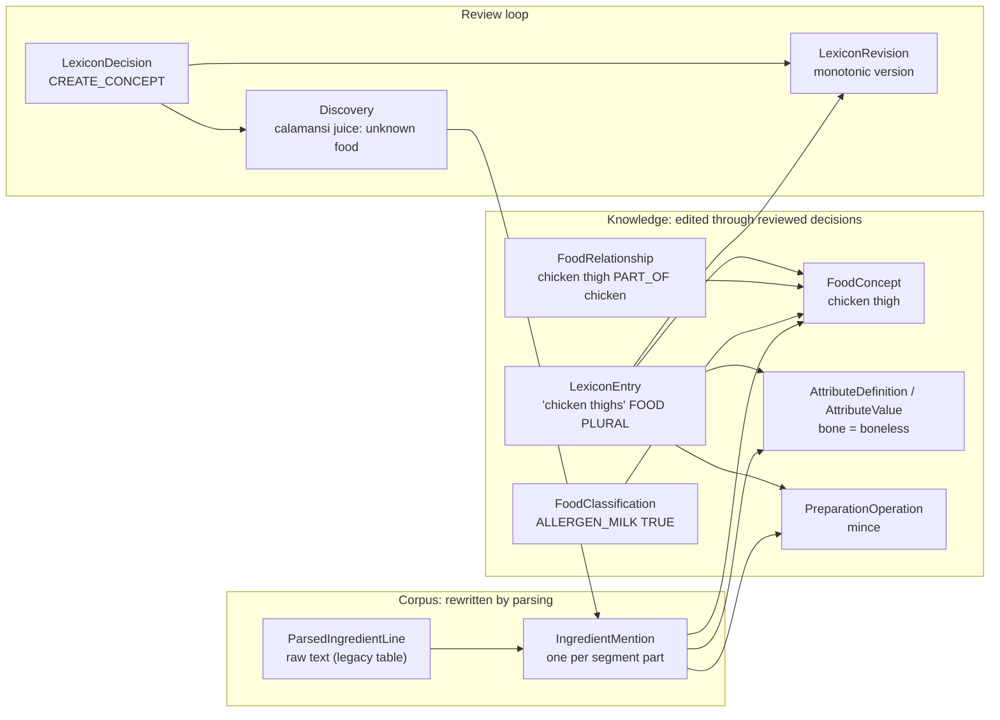
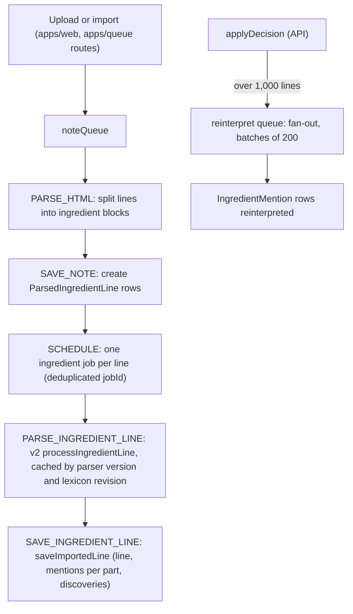
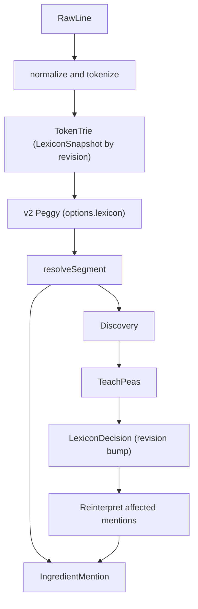

# Ingredient Parsing and Food Ontology Rebuild

Peas is moving to a Peggy-first, corpus-native, human-curated ingredient parser: a structural grammar (v2), a lexicon of typed roles fed into the grammar at parse time, a typed food ontology, and a review loop ("Teach Peas") that turns unknown or ambiguous expressions into reusable knowledge.

Related documents:

- [Prisma modernization decision](./prisma-modernization-decision.md)
- [Web modernization](./web-modernization.md)
- [Cache consistency](./cache-consistency.md)
- [Testing and coverage](../testing.md): every suite, how to run it, and the coverage floors
- [v2 parser guide](../../packages/parser/README.md): how the parser works, with worked example lines

## Phase 1 deliverables

Each item below can be seen or checked directly. Commands run from the repo root.

| # | Deliverable | How to see it |
| --- | --- | --- |
| 1 | **v2 parser explains any line.** Normalization, tokens, lexicon matches, and the syntax tree for one line. | `yarn workspace @peas/parser explain:line --lexicon demo "2 heaping cups all-purpose flour, sifted"` |
| 2 | **Unknown foods still parse.** Structure without any food knowledge. | `yarn workspace @peas/parser explain:line "3 tablespoons calamansi juice"` gives `[3 tbsp] calamansi juice` |
| 3 | **Exploratory mode previews proposed knowledge.** Two segmentations, with and without a proposed entry. | `yarn workspace @peas/parser explain:line --lexicon demo --exploratory "1 tbsp virgin olive oil"` |
| 4 | **The whole corpus parses.** At Phase 1 close, 682 of 682 exported lines parsed fully (v1: 681), in about 130 ms total versus about 70 ms per line for v1. The corpus was reset to empty on 12 November 2026 because that export included instruction text; after a fresh import, refill it and rerun the report. | `yarn workspace @peas/database export:lines`, then `yarn workspace @peas/parser corpus:baseline-v1` and `report:compare`; open `packages/parser/fixtures/reports/v1-vs-v2.md` |
| 5 | **Golden accuracy is measured, not guessed.** 182 dev cases (177 exact on quantity and phrase; 5 known failures documented) and 41 held-out cases. | Same report, "Golden sets" table |
| 6 | **Regression suite.** 272 tests: unit, golden, invariants (spans always point at raw text, parsing never throws), Zod schema round-trips, and a v1 snapshot. | `yarn workspace @peas/parser test:run` |
| 7 | **Lexicon change previews.** What changes across the corpus if an entry is added, before anyone accepts it. | `yarn workspace @peas/parser preview:lexicon --add "olive oil:FOOD"` |
| 8 | **Shared, documented schemas.** Zod schemas with worked examples for every tree node, exported from `@peas/parser/v2`. | `packages/parser/src/v2/ast/schemas.ts` |
| 9 | **Import bugs fixed.** Multi-block notes keep their `blockIndex`, re-saving a line replaces its ingredient references, parse-cache invalidation works, and ingredient jobs are deduplicated. | `yarn workspace @peas/queue test:run`; import a note with two ingredient lists and check the note page |
| 10 | **Migration history is trustworthy.** Drift baselined; the runtime-grammar tables dropped; all migrations replay cleanly on an empty database. | `SCRATCH_DATABASE_URL=... yarn workspace @peas/database db:verify-migrations` |
| 11 | **Legacy grammars unlinked but preserved.** The `/parser` rule builder and database grammar branch are gone; the old grammars and an export of the database rules are kept for reference. | `packages/parser/legacy/README.md` and `packages/parser/legacy/dynamic-archive/` |
| 12 | **Corpus export tool.** Refreshes the corpus from real imports. | `yarn workspace @peas/database export:lines` |

What Phase 1 deliberately does not deliver: imports still use v1 (v2 is wired in during Phase 5), no ontology tables exist yet (Phase 2), and nothing resolves a phrase to a food concept (Phase 3).

## Phase 2 deliverables

Phase 2 adds the storage the resolver and the review loop will write to. Nothing in the app reads or writes these tables yet; Phase 3 starts using them.

| # | Deliverable | How to see it |
| --- | --- | --- |
| 1 | **Ontology tables exist.** 21 models (concepts, lexicon entries, attributes, preparations, relationships, classifications, substitutions, products, mentions, discoveries, decisions, revisions, merge records, legacy mappings) in one additive migration. | `packages/database/prisma/schemas/ontology.prisma`; `yarn workspace @peas/database db:studio` |
| 2 | **The migration replays cleanly and matches the schema exactly**, including the pg_trgm extension, CHECK constraints, and the partial review-queue index. | `SCRATCH_DATABASE_URL=... yarn workspace @peas/database db:verify-migrations` |
| 3 | **Legacy pages are unaffected.** No legacy table or column changed; legacy queries run unchanged on the migrated database. | Start the app and open the notes, recipes, and ingredients pages |
| 4 | **The vocabulary seed is idempotent.** 11 attribute dimensions, 47 values, and 27 preparations; a second run adds nothing and leaves the revision alone. | `yarn workspace @peas/database db:seed:ontology` (twice) |
| 5 | **The database hands the parser a lexicon.** `getLexiconSnapshot()` returns UUID-keyed entries that `buildLexicon` accepts, so the parser can run on stored knowledge. | Integration test "builds snapshots the parser accepts" |
| 6 | **The hierarchy cannot loop.** IS_A and PART_OF edges that would create a cycle are rejected. | Integration test "rejects IS_A and PART_OF cycles" |
| 7 | **Classifications inherit by relationship type** (decision D15): food groups and allergens pass down every relationship (buttermilk DERIVED_FROM milk is dairy and carries the milk allergen; canned tomatoes PROCESSED_FROM tomato is a vegetable), dietary values and categories only "is a kind of"; explicit values win, including an explicit FALSE. Amended on 13 November 2026: food groups originally stopped at DERIVED_FROM and PROCESSED_FROM. | `packages/parser/src/v2/ontology/inheritance.ts`; parser and integration tests |
| 8 | **Re-parsing never clobbers a person's work** (decision D17): mention upserts are idempotent, and verified mentions are protected; disagreements become VERIFIED_DRIFT discoveries. | Integration test "protects verified mentions" |
| 9 | **The review queue has real counts and priority** (decision D18): evidence across notes, the documented priority formula, cursor paging, and decisions that close discoveries with their own revision. | Integration test "counts evidence across notes" |
| 10 | **Every section-32 example is representable.** All 15 target interpretations in `golden/semantic.json` are stored as rows and read back unchanged. | `TEST_DATABASE_URL=... yarn workspace @peas/database test:int` |
| 11 | **Shared, documented payload schemas.** Resolution, discovery, and decision payloads (one variant per type), ontology enums, inheritance rules, vocabulary, and the priority formula, each with worked examples, exported from `@peas/parser/v2`. | `packages/parser/src/v2/{ontology,resolve,knowledge}/` |
| 12 | **Test suites.** Database unit tests (22, including a check that every Prisma enum matches its parser list) and integration tests (29) against a throwaway database; 16 new parser tests. | `yarn workspace @peas/database test:run`; `test:int` with `TEST_DATABASE_URL` |

What Phase 2 deliberately does not deliver: no resolver (Phase 3), no Teach Peas screens or decision side effects (Phase 4), no lexicon entries yet (the reviewed v1 descriptor seed lands in Phase 3), and no legacy ingredient migration (the mapping table exists; the migration runs later).

## Phase 3 deliverables

Phase 3 turns syntax into meaning: a pure resolver picks the food concept, attributes, preparations, and modifiers for each segment, and two seeds fill the ontology (reviewed modifiers from the v1 descriptor list, and concepts from legacy ingredients). Imports still use v1 until Phase 5.

| # | Deliverable | How to see it |
| --- | --- | --- |
| 1 | **Lines resolve to concepts.** `processIngredientLine` parses and resolves a line; each mention gets a status (AUTO_RESOLVED, NEEDS_REVIEW, UNRESOLVED), a score, and reasons such as `head:chicken thigh(2 tokens)`, `entry:PLURAL`, or `package:can->canned tomatoes`. | `packages/parser/src/v2/resolve/`; the parser README walks through examples |
| 2 | **Every section-32 example resolves as intended.** 15 of 15 semantic cases, including whole milk as its own concept, attributes only when they apply to the head, preparations with degree ("finely chopped"), cans implying canned tomatoes, and calamansi juice staying UNRESOLVED. | `yarn workspace @peas/parser test:run`; "Semantic precision" in `packages/parser/fixtures/reports/resolution.md` |
| 3 | **Behavior is stable under harmless edits.** Metamorphic tests: case, plurals, an added preparation, trailing notes, and removing an entry each change only what they should. | `src/v2/__tests__/process-line.metamorphic.test.ts` |
| 4 | **Coordination is handled.** "salt and pepper" splits into two parts (`partIndex`); "macaroni and cheese" stays one food when it is an entry; "milk or cream" becomes alternatives that need review. | `src/v2/__tests__/coordination.test.ts` |
| 5 | **A verified alias works without touching the grammar.** Adding an entry ("icing sugar", "stinking rose") changes resolution immediately. | Parser exploratory test and database integration test |
| 6 | **Reviewed modifier seed.** 99 entries (preparations, degrees, measurement modifiers, instructions, attributes) chosen from the 910-word v1 descriptor list; the rest are classified in a candidates file for later review. Idempotent. | `yarn workspace @peas/parser extract:descriptors`; `yarn workspace @peas/database db:seed:modifiers` (twice) |
| 7 | **Legacy ingredients seed the ontology without inventing hierarchy.** Three resumable passes keyed by `LegacyIngredientMapping`; parents become RELATIONSHIP_SUGGESTION discoveries, never IS_A edges; properties, categories, tags, substitutions, brands, and composed flags carry over. On the dev database: 10 legacy ingredients, 10 concepts, 10 mappings, 0 relationships; a second run changes nothing. Replaced in Phase 5 by the starter-foods seed (`db:seed:foods`); the script and its 10 dev concepts were removed. | Historical; see Phase 5 deliverable 10 |
| 8 | **The database hands the resolver everything it needs.** `loadResolverSnapshot()` returns entries with targets, vocabulary, concepts, relationships, applicability, concept attributes, verified-choice priors, and the revision, as plain JSON for caching. | Integration test "feeds loadResolverSnapshot" |
| 9 | **Resolution is measured.** Coverage by status, top unresolved phrases, ambiguous lexemes, semantic precision, and coverage and precision at score thresholds 0.5, 0.7, and 0.9, from the fixture snapshot or the live database. | `yarn workspace @peas/parser evaluate:resolution`; `yarn workspace @peas/database db:evaluate:resolution` |
| 10 | **Test suites.** 49 new parser tests (resolver, metamorphic, coordination, exploratory, branches, report, seed file) and 8 new database integration tests; parser coverage 96.6% statements and 88.3% branches. | `yarn workspace @peas/parser test:coverage`; `TEST_DATABASE_URL=... yarn workspace @peas/database test:coverage` |

What Phase 3 deliberately does not deliver: no Teach Peas screens (Phase 4), no queue integration or mention writes during import (Phase 5), and no storage for coordination parts yet (mentions are keyed by `(parsedLineId, segmentIndex)`; Phase 5 adds `partIndex`). Legacy-seeded concepts for unreviewed ingredients are PROPOSED, so conservative imports ignore them until a reviewer promotes them.

## Phase 4 deliverables

Phase 4 puts the resolver to work on stored lines and lets a person teach Peas. Mentions and discoveries are written by a backfill; a review queue and focused cards turn discoveries into decisions; every decision bumps the lexicon revision, shows its impact before it is applied, and reinterprets the affected mentions. Imports still parse with v1 until Phase 5.

| # | Deliverable | How to see it |
| --- | --- | --- |
| 1 | **Every active line has v2 mentions.** The backfill resolves each active `ParsedIngredientLine`, writes one mention per segment and the discoveries it suggests, logs a checkpoint per batch for `--after`, and never writes legacy tables. A second run changes nothing; verified mentions are never touched. On the dev database: 737 lines, 738 mentions, 365 unknown-food discoveries; the second run changed 0 mentions. | `yarn workspace @peas/queue backfill:mentions` (twice) |
| 2 | **Typed discoveries in priority order.** Unknown food phrases (with words that name existing concepts as hints), unknown modifiers (with roles suggested by position and spelling), attribute meanings, identity questions (shown once two notes support them), ambiguous phrases, and relationship suggestions by name. Adjacency mining adds "appears before chicken thigh in N notes" counts. | `/teach` (admin), `discover()` in `@peas/parser/v2` |
| 3 | **Decisions with real effects.** All 12 decision types write their effects in one transaction under one revision: entries (with generated plurals), concepts, relationships (cycle-checked), applicability, attribute values, ignored words, merges, mention corrections, and reverts. Every created or changed row is recorded so REVERT puts it back. | Integration tests "writes the same knowledge as the in-memory preview for every decision type" and "reverts a decision" |
| 4 | **Before/after impact without side effects.** `previewDecision` applies the decision to an in-memory snapshot (`applyDecisionToSnapshot`), re-resolves the affected mentions both ways, and reports counts plus examples. Verified mentions that would read differently are shown as conflicts and never changed. | The impact panel on each review card; `/teach/playground` "Simulate decision" |
| 5 | **Applying reinterprets right away.** Up to 1,000 affected lines are reinterpreted in the same request, and the confirmation reports how many mentions changed ("Taught: icing sugar is powdered sugar; 1 mention updated"). Larger decisions return a `reinterpret` command. | Scenario A in `apps/web/tests/teach.spec.ts`; `yarn workspace @peas/queue reinterpret --revision <r>` |
| 6 | **Concept merge that can be undone.** Entries, relationships, classifications, attributes, applicability, mentions (verified too), legacy mappings, products, substitutions, and tags move to the survivor; contradicting classifications abort; a snapshot on `ConceptMergeRecord` lets REVERT restore everything. | Integration tests "moves every reference to the survivor" and "aborts on contradicting classifications" |
| 7 | **Teach Peas screens.** Review queue with type filters and counts, focused review card (radio-group options per discovery type, examples drawer, live impact preview, keyboard shortcuts `j`/`k`/`1`-`9`/`e`/`Enter`/`d`), playground, concept list and concept page (names by kind, relationships both ways with an add form, inherited classifications marked, example mentions, decisions with revert), and a mention panel with a Correct control on every note line. | `/teach`, `/teach/playground`, `/concepts`, and any note page (admin) |
| 8 | **Scenarios A, B, C, and E pass end to end**, plus a keyboard-only review, in Chromium and WebKit; axe WCAG 2.1 AA scans of the queue, a review card, and a concept page at desktop and mobile widths report no violations. | `TEST_DATABASE_URL=... yarn workspace @peas/web test:e2e tests/teach.spec.ts tests/teach.a11y.spec.ts` |
| 9 | **Test suites.** 50 new parser tests, 11 database and 5 API integration tests, 17 API, 18 features, and 7 web unit tests, and 16 end-to-end tests; coverage floors raised in every package. | `yarn test:coverage` with `TEST_DATABASE_URL` |

What Phase 4 deliberately does not deliver: imports still use v1 and mentions are not written during import (Phase 5); coordination splits store their first part only and go to review (Phase 5 adds `partIndex`); reinterpretation above 1,000 lines is a command, not a queue job (Phase 5); structural-pattern discoveries (Phase 6).

## Phase 5 deliverables

Phase 5 is the cutover: imports parse and resolve with v2 only, nothing is written to the legacy ingredient tables, the read paths move to mentions and concepts, and decisions that touch many lines reinterpret them in a background queue with visible progress. A `pg_dump` of the dev database was taken first (`~/peas-backups/peas-dev-before-phase5-20261112-1757.dump`); rollback means reverting the code and restoring that dump.

| # | Deliverable | How to see it |
| --- | --- | --- |
| 1 | **Imports run on v2 only.** The parse step runs `processIngredientLine` in CONSERVATIVE mode with the queue's cached resolver context and stores the Zod-validated result on the job; the parse status reflects syntax only (PARSED succeeds, PARTIAL and FAILED are errors) and resolution never fails a job. The save step calls `saveImportedLine`, one transaction that upserts the line by `(noteId, blockIndex, lineIndex)`, its mentions (verified ones protected), and its discoveries. No `ParsedSegment`, `IngredientReference`, `Ingredient`, `ParsingRule`, or `UniqueLinePattern` writes remain, and saving the same line twice adds nothing. | Import a note and open it; integration test "stores one mention per coordinated part, is idempotent, and never writes legacy tables" |
| 2 | **Every coordinated part is stored.** `IngredientMention.partIndex` joins the unique key `(parsedLineId, segmentIndex, partIndex)`, so "Salt and parsley" stores salt as part 0 and parsley as part 1, each resolved; the Phase 4 `parts_not_stored` workaround is gone. | Migration `20261113000000_mention_parts_and_reinterpret_runs`; the same integration test |
| 3 | **The queue caches knowledge by revision.** `lexicon-cache.ts` keeps one resolver context per process: within 15 seconds it is reused; after that the revision is read and only a changed revision loads a snapshot (Redis `lexicon:snapshot:<revision>` first, then the database, which fills Redis). Every decision announces its revision on the `lexicon:revision` channel so all queue processes recheck right away. Parse-cache keys include the parser version and the revision (`action:parse_ingredient_line:v2:<version>:<revision>:<line>`). Logs: `[LEXICON_CACHE]`, `[V2_PARSE]`, `[V2_SAVE]`. | `apps/queue/src/services/ingredient/lexicon-cache.ts` and its tests |
| 4 | **Large decisions reinterpret in the background.** When a decision affects more than 1,000 lines, the API posts to the queue's `POST /reinterpret`; the run (`reinterpret-<revision>`, one per revision, so repeats are no-ops) selects the stale lines, splits them into batches of 200 with deterministic ids (`reinterpret-<revision>-<n>`, 3 attempts with backoff), and skips lines that are already fresh, so retries and overlapping runs are safe. Progress lives in `ReinterpretRun`, `Query.job` reports it, `effect.reprocessingJobId` hands it to the cache coordinator, and a banner on the Teach Peas pages shows "Updating mentions in the background: 400 of 1,200 lines" until it finishes. The `reinterpret` CLI remains, and the API returns it as a fallback when the queue is unreachable. | `apps/web/tests/reinterpret.spec.ts`; integration test "selects stale lines, batches them deterministically, closes the run, and skips fresh lines on a retry" |
| 5 | **Read paths use mentions and concepts.** Note and recipe lines render the v2 highlighted line (words styled by role) with the mention panel; recipe lines link their concepts. `/ingredients` lists approved foods for everyone and links to concept pages, which everyone can read; admins edit classifications (dietary properties, food groups, allergens, `CATEGORY:<name>`), tags, and substitutions on the concept page. Recipes filter by concept, including IS_A and PART_OF descendants ("chicken" finds chicken thighs), from a "Recipes with …" link on each concept. The dashboard counts concepts and ranks concepts by the lines that mention them. Navigation shows Ingredients for everyone and, after the ingredient card restore, a single Knowledge entry for admins. | `apps/web/tests/ingredients.spec.ts`, `concepts.spec.ts`, and `notes.spec.ts` |
| 6 | **Import health is measured.** `GET /metrics/ingredients` on the queue returns the last hour of parses (lines per second, share of structurally parsed lines, resolution coverage, candidates per part, unknown words) plus corpus counts; ingredient job metrics carry `parseStatus`, `resolutionStatuses`, `unknownTokens`, `candidateCount`, and `lexiconRevision`. A Corpus health card on `/teach` shows lines with mentions, resolved and verified mentions, open discoveries, the most frequent unknown phrases, the reinterpretation backlog, and the live numbers when the queue answers. | `/teach` (admin); `apps/queue/src/routes/metrics.ts` |
| 7 | **The legacy paths are gone from the code.** The pattern-tracking queue, worker, and `/patterns` route; `parser-resolver.ts` and the v1 parse cache; the unused `DatabaseOperations` legacy writer; the GraphQL ingredient queries and mutations and their `INGREDIENTS`/`INGREDIENT_DETAIL` domains; `packages/features/src/{ingredients,parsed-line}` and their stories. The legacy tables themselves remain until Phase 7. | `git status` |
| 8 | **Job polling survives effect re-runs.** The cache coordinator was disposed when React cleaned up and re-ran the provider's effect on the same instance, which silently stopped every job poll in development; it now resumes. | Web unit test "tracks jobs again after an effect disposes and resumes the same coordinator" |
| 9 | **Test suites.** New queue tests (lexicon cache, processor, v2 parse and save, reinterpret services, actions, worker, and routes, ingredient metrics), database integration tests (cutover, starter foods, approval, the ingredients list), API integration tests, API, features, and web unit tests, and end-to-end tests for ingredients, concepts, note mentions, and reinterpretation progress (31 per browser, all passing in Chromium and WebKit). Coverage floors hold or rose everywhere. | `yarn test:coverage` with `TEST_DATABASE_URL`; `yarn workspace @peas/web test:e2e` |
| 10 | **A small, realistic starter ontology.** `db:seed:foods` loads 28 everyday foods from `starter-foods.seed.json` (chicken with its thighs, breasts, wings, drumsticks, and ground chicken; milk, whole milk, butter, heavy cream; salt, kosher salt, sugar, powdered sugar, flour; garlic and cloves, onions, lemons with juice and zest, tomatoes and canned tomatoes, parsley; olive oil, extra-virgin olive oil, vegetable oil) with plural and alias names, 14 relationships, characterizing attributes, and attribute applicability, so "1 lb boneless skinless chicken thighs" resolves to chicken thigh with both attributes. Chicken drumstick and lemon zest stay proposed. Idempotent. It replaced the legacy-ingredient seed. | `yarn workspace @peas/database db:seed:foods` (twice) |
| 11 | **An ingredients page of approved foods.** `/concepts` is the admin workbench showing every concept. Admins approve a proposed food with an Approve button, an `APPROVE_CONCEPT` decision (the 13th type) that verifies the concept and activates its proposed names under a new revision, with a before/after preview, reinterpretation of affected mentions, and revert. | `apps/web/tests/concepts.spec.ts`; integration test "approves a proposed food" |
| 12 | **The ingredient card view, backed by concepts.** `/ingredients` keeps the original card view for everyone: Approved (VERIFIED concepts) and Needs review (PROPOSED), the same groupings, and an editable card. Saving marks a food reviewed (approving a proposed one). Name, plural, alternate names, and base ingredients (any number, each with its relationship type: is a kind of, is part of, is made from, is processed from) go through one `EDIT_CONCEPT` decision (the 14th type: rename, add names, change name kinds, retire names, add or retire relationships), so they are revisioned, reinterpreted, and revertible; properties map to classifications, category to `CATEGORY:<name>`, and tags, substitutions, and composed are written directly (`packages/database/src/ontology/ingredient-card.ts`). | `apps/web/tests/ingredients.spec.ts`; database integration test `ingredient-card.int.test.ts`; API integration test `ingredients.int.test.ts` |
| 13 | **One Knowledge section.** The review queue, Concepts, and a new Lexicon page (every entry with its role, kind, status, and meaning; `lexicon(query, role, page)`) share tabs and the reinterpretation banner; the navigation shows Dashboard, Import, Ingredients, Recipes, Notes, and Knowledge. Who may curate is one function on each side (`canCurateKnowledge` in the API context and in `apps/web/src/lib/permissions.ts`), open to every signed-in user for now; deleting all data and promoting notes stay admin-only. |
| 14 | **Base foods and their variants.** The Approved list shows every approved food, variants in italics; each base card lists the foods that relate to it, grouped by relationship, and the pickers can add a missing food inline. The starter seed leads every derived food back to a base (33 foods, 12 bases: chicken, garlic, lemon, milk, oil, olive, onion, parsley, salt, sugar, tomato, wheat; cream and flour joined, and plain "flour" now resolves to flour rather than all-purpose flour). | Database test "lists every approved food, variants included"; `apps/web/tests/ingredients.spec.ts` | `apps/web/tests/concepts.spec.ts` ("moves between the Knowledge tabs and searches the lexicon") |
| 15 | **Card properties follow the ontology.** Core types (food groups) and allergens are classifications on the concept, so they inherit (across every relationship); the card shows inherited ones with their source and can store an explicit "does not contain" (FALSE) override. Vegan, vegetarian, and gluten-free are automatic tags computed from effective properties (vegetarian: no meat or fish; vegan: also no dairy or egg; gluten-free: no gluten; nothing without a core type) and shown as fixed chips in the Tags field, Gluten and Alcohol are allergens (`ALLERGEN_GLUTEN`, `ALLERGEN_ALCOHOL`), and a food made or processed from another counts as composed. The list groups by effective properties, computed in two queries for the whole list (`getEffectiveClassificationsForMany`). | Database tests "shows inherited properties…" and "computes vegan and vegetarian…"; card unit tests |
| 16 | **Properties live on base foods.** The starter seed sets properties on the 12 bases (chicken meat; milk dairy; wheat grain with gluten; tomato, garlic, and onion vegetables; lemon and olive fruits; parsley herb; salt seasoning; sugar sweetener; oil "oil & fat"), so every variant inherits them and gets its automatic tags; new core types Oil & Fat, Sweetener, and Seasoning cover foods that fit no other. Kosher salt also answers to "coarse salt", and cream accepts fat-content attributes. Applied to dev on 13 November 2026, with the duplicate values set by hand on canned tomatoes, all-purpose flour, and lemon zest removed so they inherit. | `starter-foods.seed.json`; seed integration test |
| 17 | **Starter foods start in review.** The seed's top-level `"status": "PROPOSED"` puts every starter food (and its names) in the ingredients page's Needs review queue, so imports don't resolve to them until someone approves each one; a food's own status overrides it, and tests seed with `status: "VERIFIED"`. Dev's 33 starter foods were set back to proposed on 13 November 2026 (revision 7). | Seed integration test "puts every starter food in the review queue by default" |

Deviations from the plan, and why:
- Reinterpretation progress is stored in `ReinterpretRun` and polled through `Query.job`, not pushed through `statusBroadcaster`: the existing cache coordinator already polls job ids, and a table survives queue restarts.
- The API announces revisions through the queue (`POST /reinterpret/lexicon-revision`) because the API has no Redis connection; the 15-second TTL still applies if that call fails.
- Concept editing (classifications, tags, substitutions) uses direct admin mutations rather than decisions: none of them changes how a line resolves, so there is nothing to reinterpret and no revision to bump.
- Categorization and the completion check needed no change: categorization reads only Evernote metadata, and completion counts saved lines in memory; neither reads a legacy ingredient table.

What Phase 5 deliberately does not deliver: the legacy tables and their repositories are still in the schema (Phase 7 drops them); categorization does not yet use concept classifications; `REPARSE_BY_VERSION` runs exist in the queue and database but nothing starts them until Phase 6 bumps the grammar; live metrics are per queue process and start empty after a restart; the progress banner only appears in the tab that applied the decision.

## Phase 6 deliverables

Status (13 November 2026): implemented in the working tree; migrations `20261113020000_corpus_health_snapshots` and `20261113030000_edit_concept_decision` are applied to dev. Phase 6 makes grammar changes follow one loop (discovery, fixtures, grammar change, version bump, dry run, reparse), adds corpus health trends, and calibrates automatic resolution.

| # | Deliverable | Evidence |
| --- | --- | --- |
| 1 | **Structural pattern discoveries.** `structureSignature(syntax)` maps a line to token classes (`N` number, `F` fraction, `U` unit, `W` unknown word, `L` lexeme, punctuation kept), and `structuralIssue` flags lines that don't parse (`UNPARSED`), leave a number or unit stranded inside the food phrase (`QUANTITY_IN_PHRASE`, "rosemary a few sprigs" is `W U`), or are headings (`HEADING`, "For the glaze:" is `W :`). `discover()` emits `STRUCTURAL_PATTERN` keyed by signature; when a line is rewritten without the problem, its stale structural evidence is dropped and an empty discovery resolves. | `structure-signature.test.ts`; database integration test "records structural patterns on import" |
| 2 | **A review card for structure.** Structural patterns can't be taught from the queue, so their card replaces the decision options with Export as fixtures (`Discovery.fixtureBlock`: up to 10 example lines as pending golden cases with v2's current reading, plus a Copy button), Mark as noise (`markDiscoveryAsNoise`: the lines become inactive, leave mentions, counts, and reparsing, and the discovery is rejected), and Defer. | `apps/web/tests/grammar-loop.spec.ts`; API integration test `grammar-loop.int.test.ts` |
| 3 | **Pulling fixtures.** `yarn workspace @peas/parser pull:fixtures --discovery <id>` (or `--signature "W U"`) writes `fixtures/golden/pending/<slug>.json` with the same cases (`draftGoldenCases`). The script lives in `@peas/database` so the parser never depends on the database. | `packages/database/scripts/pull-fixtures.ts` |
| 4 | **A grammar change through the loop.** Size words before a unit ("Small handful of whole black peppercorns", "small handful coriander, chopped", "garlic 1 small clove, crushed") parse with `SizeWord`, including implied units without "of"; `PARSER_VERSION` is 2.1.0 and those three known failures (corpus-004, corpus-124, corpus-134) now pass. `SYNTAX_UPGRADES` and `upgradeStoredSyntax` (used when mentions are read) carry stored syntax across a future major bump. | `fixtures/golden/structural.dev.json`; `upgrade.test.ts` |
| 5 | **Dry run, then reparse.** `yarn workspace @peas/queue reparse:dry-run` re-reads every stored mention with the working-tree parser and writes `fixtures/reports/reparse-<version>.md` (changed parse status, quantity, head concept, unresolved spans, and segments, 50 examples each, and verified mentions whose structure would change, which are never applied). `yarn workspace @peas/queue reparse`, `POST /reinterpret/reparse`, and the Health tab's Reparse button start the `REPARSE_BY_VERSION` run (`reparse-<version>`, once per version), whose progress shows in the Knowledge banner. | `apps/queue/scripts/reparse-dry-run.ts`, `reparse.ts`; queue route tests |
| 6 | **Corpus health trends.** `CorpusHealthSnapshot` stores totals by resolution and parse status, by parser version, open discoveries by type, verified count, and average candidates. Snapshots run daily (03:00), after every reinterpretation or reparse run (keyed by run, so one per run), and on request. `LexiconDecision.mentionsChanged` accumulates in-request and background reinterpretation, so "taught to fixed" is measured. The Health tab (`/teach/health`) charts coverage over time, unresolved share by parser version, and decisions per week (each chart in plain SVG with its data table), and lists the top unknown and most ambiguous phrases linked to their cards. | `corpusHealthTrends`; queue service tests; Health tab end-to-end test with axe on desktop and mobile |
| 7 | **Exploratory sweeps.** A weekly job (Sunday 04:00) and the Run sweep button re-read unresolved and needs-review mentions in EXPLORATORY mode and record only discoveries, tagged `source: "exploratory"`; existing discoveries keep their payloads. | Database integration test "sweeps unresolved mentions in exploratory mode without writing mentions"; queue tests |
| 8 | **Calibrated automatic resolution.** `yarn workspace @peas/parser calibrate:thresholds` scores every `minMargin` and `maxUnknownForAuto` combination against the semantic golden set, plus verified mentions passed with `--labels` (exported by `yarn workspace @peas/database export:calibration-labels`), and recommends the most permissive setting at 98% precision. The current setting holds on the semantic set (100% precision, 93.3% coverage). `minMargin` changes nothing today, because the resolver auto-resolves only a single remaining candidate; on labels with unknown words next to a known food (the test database's verified mentions), `maxUnknownForAuto` 1 raises coverage at full precision, so it is the knob to revisit once real verified mentions exist. Ties keep knobs that change nothing at their current value. | `fixtures/reports/calibration.md`; `calibration.test.ts` |
| 9 | **Test suites.** Parser unit tests, database and API integration tests, queue tests for snapshots, sweeps, schedules, and routes, feature tests for the structural card and the Health tab, and end-to-end tests (37 per browser, all passing in Chromium and WebKit). API integration tests and the end-to-end server point `QUEUE_INTERNAL_URL` at an unreachable address, so a queue running locally (against the dev database) is never called. | `yarn test:coverage` with `TEST_DATABASE_URL`; `yarn workspace @peas/web test:e2e` |

Deviations from the plan, and why:
- The structural criterion is wider than "PARTIAL or FAILED": a line that parses can still strand a quantity inside the phrase or be a heading, and those are the patterns worth reviewing.
- `takeHealthSnapshot` runs in the API rather than through the queue, so the button answers right away; the queue's `POST /reinterpret/snapshot` remains for scripts.
- Run sweep lives on the Health tab with the other maintenance controls, not on the queue page.
- The snapshot row also records its trigger, total lines, and counts by parser version, which the charts need.

What Phase 6 deliberately does not deliver: the dev database has no imported lines yet, so the loop has been exercised on fixtures and the test database rather than on real reparsed data; calibration labels are the semantic golden set until there are verified mentions; ranges with mixed units ("800g–1kg") and postfix quantities ("rosemary a few sprigs") remain open structural patterns.

## Where things stand (Phase 6)

| Area | State |
| --- | --- |
| v2 parser (`packages/parser/src/v2`) | Built: normalizer with raw-offset map, tokenizer, exact rationals, unit table, token trie with conservative and exploratory segmentation, Peggy grammar ported from v1, Zod schemas, `parseLine`. Lexicon entry ids must be UUIDs. |
| Shared ontology schemas (`@peas/parser/v2`) | Ontology enums, D15 inheritance rules, starting vocabulary, resolution, mention syntax, discovery, and decision payload schemas, D18 priority formula |
| Resolver (`@peas/parser/v2`, `src/v2/resolve/`) | `buildResolverContext` (snapshot to lexicon plus ontology view), `resolveSegment`, `scoreCandidate`, `processIngredientLine`, `buildResolutionReport`; `RESOLVER_VERSION` 1.0.0. Pure: no database access. |
| Teaching logic (`@peas/parser/v2`, `src/v2/knowledge/`, `src/v2/preview/`) | `discover`, `suggestRelationships`, `applyDecisionToSnapshot`, `decisionScope`, `generatePlural`, `diffResolution`, `summarizeResolution`, `structureSignature`, `draftGoldenCases`, `calibrateThresholds`, `upgradeStoredSyntax`. Pure. `PARSER_VERSION` 2.1.0. |
| Ontology storage (`packages/database`) | 23 models in `prisma/schemas/ontology.prisma` (Phase 5 adds `ReinterpretRun` and `IngredientMention.partIndex`; Phase 6 adds `CorpusHealthSnapshot` and `LexiconDecision.mentionsChanged`), repositories in `src/repository/ontology/` (plus `loadResolverSnapshot`, `applyDecision`, `mergeConcepts`, `previewDecision`, `backfillMentions`, `saveImportedLine`, reinterpretation runs, concept editing, ingredient cards, `getCorpusHealth`, health trends, and the grammar loop), vocabulary, modifier, and starter-food seeds |
| Review UI (`apps/web`, `packages/features`, `packages/api`) | GraphQL queries and mutations for ingredient cards (concept-backed; everyone), discoveries, concepts, the lexicon, mentions, playground, preview, decisions (14 types, including `APPROVE_CONCEPT` and `EDIT_CONCEPT`), and corpus health; routes `/ingredients`, and the admin Knowledge section `/teach`, `/teach/$discoveryId`, `/teach/playground`, `/concepts`, `/concepts/$id`, `/lexicon`; `/teach/health`; the structural review card; highlighted lines and the mention panel on note and recipe pages; invalidation domains `DISCOVERIES`, `CONCEPTS`, `CONCEPT_DETAIL`, `MENTIONS`, `CORPUS_HEALTH` |
| Regression fixtures | Corpus (reset to empty on 12 November 2026; refilled from fresh imports with `export:lines`), 182 dev cases (5 known failures), 41 held-out cases, structural, demo, and semantic lexicons (the semantic lexicon now carries a small ontology), `modifiers.seed.json`, v1 descriptor candidates, v1 baseline and snapshot |
| Reports and tools | `report:compare` (v1 vs v2), `evaluate:resolution` and `db:evaluate:resolution` (resolution report), `preview:lexicon` (before/after preview of a lexicon change), `explain:line`, `extract:descriptors`, `backfill:mentions` and `reinterpret` (queue scripts) |
| Import pipeline | v2 only: parse with the cached resolver context, save mentions and discoveries with `saveImportedLine`; background reinterpretation and reparses, health snapshots (daily and after runs), and weekly exploratory sweeps on the `reinterpret` queue; `GET /metrics/ingredients` |
| Legacy grammars | The old v2 stub and the runtime-compiled grammar moved to `packages/parser/legacy/` (reference only); database grammars archived and their tables dropped |
| Database | 47 migrations, all applied to dev; `db:verify-migrations` replays them on a scratch database; integration tests run against `TEST_DATABASE_URL` |

## Ontology data model

The ontology separates what a food *is* from what it is *called* and from where it *appears*:



- **Concepts** are identities ("chicken thigh"). They have no name column beyond `canonicalName`; every way of writing them is a `LexiconEntry`.
- **Lexicon entries** say "this text plays this role and points at this target": a FOOD entry points at a concept, an ATTRIBUTE entry at an attribute value, a PREPARATION entry at an operation, and DEGREE, MEASUREMENT_MODIFIER, and INSTRUCTION entries at a value key such as `fine`. A CHECK constraint enforces that pairing. Entries are unique per `(matchKey, targetKey)`, so "green" can be both color=green and ripeness=unripe but not color=green twice.
- **Mentions** store one part of a parsed segment each ("salt and pepper" is one segment with two parts): the syntax tree, the quantity, the chosen concept, attributes, preparations, and modifiers, plus the versions that produced them (parser, normalizer, resolver, lexicon revision).
- **Discoveries** collect evidence (mentions) for something a reviewer should look at; **decisions** record what the reviewer chose, each with its own **revision**.
- Columns that point at legacy tables (`Recipe`, `Brand`, `IngredientTag`, `ParsedIngredientLine`, `User`) stay text because those tables use cuid ids. Every new table uses UUIDv7 ids stored as native `uuid` columns.
- The migration adds constraints Prisma cannot express (CHECK constraints, a partial index, the pg_trgm extension). `prisma db push` would drop them, which is another reason schema changes go through migrations only.

## Current architecture



- Raw lines are stored in `ParsedIngredientLine.reference`, keyed by `(noteId, blockIndex, lineIndex)`, so the corpus can always be reparsed.
- Identity lives in the ontology (`FoodConcept`, `LexiconEntry`, `IngredientMention`). The legacy `Ingredient` / `Alias` tables are no longer read or written by the app and are dropped in Phase 7.

## Target architecture



Everything up to and including the resolver is pure TypeScript in `packages/parser/src/v2` with no database access. Persistence lives in `packages/database`, jobs in `apps/queue`, and UI in the web app.

## Dependency map

Code that touches ingredient parsing or identity after Phase 5:

- **Queue:** `parse-ingredient-line`, `save-ingredient-line`, `schedule-categorization`, `check-completion`, `lexicon-cache.ts`, `ingredient-processor.ts`, `cached-ingredient-parser.ts`, `ingredient-metrics.ts`, the `reinterpret` services, worker, and routes, and `routes/metrics.ts`.
- **Web:** `/notes/$id` and `/recipes/$id` (highlighted v2 lines and the mention panel), `/recipes?concept=`, `/concepts`, `/concepts/$id`, `/lexicon`, `/ingredients`, and the review routes `/teach`, `/teach/$discoveryId`, `/teach/playground` (`apps/web/src/routes/_authed/`); `lib/concepts.ts` and `lib/apollo/use-reinterpret-progress.ts`.
- **Features:** `packages/features/src/{notes,ingredients,concepts,knowledge,teach}` (`IngredientLineText`, `IngredientsPageContent` and `IngredientCard`, concept editors and the Approve button, `KnowledgeTabs`, `LexiconPageContent`, `CorpusHealthCard`, `ReinterpretProgressBanner`).
- **Database:** `repository/ontology/` (Phase 2: revision, lexicon, concepts, relationships, attributes, classifications, mentions, discoveries, decisions, legacy mapping; Phase 3: resolver snapshot; Phase 4: apply-decision, merge, preview, backfill, adjacency; Phase 5: `saveImportedLine`, reinterpret runs, concept editing, corpus health), plus `note.ts`, `recipe.ts` (concept filter), and `dashboard.ts` (top concepts). The legacy `repository/{ingredient,parsing-rule,pattern}.ts` remain only until Phase 7. Seeds in `src/seed/` (vocabulary, modifiers, starter foods).
- **API:** `packages/api/src/resolvers/teach.ts`, `teach-views.ts`, `concept-editing.ts`, `corpus-health.ts`, and `queue-client.ts` (background reinterpretation, revision announcements, live metrics).

## Design decisions

1. **v2 is a code-reviewed grammar.** Grammar changes go through pull requests with regression fixtures. Pre-v2 parsing can be retired at any time; old grammar files stay in `packages/parser/legacy/` as reference and are never built, exported, linted, tested, or imported.
2. **v2 is ported from v1, not rewritten.** Number, fraction, range, unit, and package rules were ported; descriptor and ingredient lists were dropped. The v1 descriptor list becomes the first modifier seed in Phase 3.
3. **The lexicon is fed into Peggy through parse options.** Matches come from an in-memory token trie keyed by start offset; the grammar consumes them with a predicate plus a function-boundary repetition. No database queries during parsing and no grammar regeneration when knowledge changes.
4. **One lexicon table with typed roles** (`FOOD`, `ATTRIBUTE`, `PREPARATION`, `DEGREE`, `MEASUREMENT_MODIFIER`, `INSTRUCTION`). One phrase may carry several entries; uniqueness is `(matchKey, targetKey)`, where `targetKey` is `food:<conceptId>`, `attr:<attributeValueId>`, `prep:<preparationId>`, or `<role>:<valueKey>`, and `matchKey` is `entryMatchKey(text)` (lowercased tokens joined by spaces). Phase 2 uses `matchKey` rather than the plan's `normalized` so that "Kosher Salt" and "kosher salt", which the parser matches identically, cannot be stored twice for the same target.
5. **Units are data in code** (`v2/quantity/units.ts`). Food parts ("thigh", "zest", "leaves") are lexicon entries, never units.
6. **Two parse modes.** `CONSERVATIVE` (imports) uses only active entries, leftmost-longest. `EXPLORATORY` (curation) also uses proposed entries and returns ranked alternative segmentations; skipping a match is only explored when it frees an overlapping match.
7. **An unknown food must still parse** ("3 tablespoons calamansi juice" gives `[3 tbsp] calamansi juice` with an empty lexicon). Permanent test.
8. **Knowledge changes bump a monotonic `LexiconRevision`**; every lexicon cache keys on it.
9. **Reinterpret and reparse share machinery.** A lexicon change reruns the (pure, fast) parse; a grammar change bumps `PARSER_VERSION`.
10. **Preparations record position (`PRE_HEAD` / `POST_HEAD`), not timing.**
11. **Plurals and variants are explicit entries**; the matcher has no morphology.
12. **Normalization is versioned and non-destructive** (`NORMALIZER_VERSION`): Unicode compatibility forms, vulgar fractions, dash, quote, and space variants. Case, hyphens, and words are preserved.
13. **Offsets are UTF-16 code units into the raw string, half-open.** The normalizer maps every normalized character back to its raw source; one tokenizer defines token boundaries for both the trie and the grammar.
14. **Concept promotion is a reviewed decision**, never a frequency threshold.
15. **Classification inheritance depends on relationship type** (config, computed at read time; explicit values win).
16. **Legacy fields get explicit destinations** (substitutions, composed ingredients, brands, categories, tags).
17. **Verified mentions are never overwritten automatically.**
18. **Review priority is a tested formula**; one decision applies to all of a discovery's evidence.
19. **Shared Zod schemas live in `@peas/parser/v2`.**
20. **Scale:** the full lexicon and corpus reinterpretation fit in memory; previews prefilter with a trigram index.
21. **Ontology ids are UUIDs.** New tables use UUIDv7 (time-ordered, index-friendly) stored as native `uuid`; lexicon entry ids must be UUIDs everywhere, including fixtures (`buildLexicon` rejects anything else). Legacy tables keep their cuid ids.
22. **Repository code stays portable.** Writes are flat, transaction-scoped statements (no nested `connectOrCreate` or atomic `increment`), unique violations are recognized only in `isUniqueViolation`, and every JSON column is validated with its Zod schema on write and read (`parseOrThrow`).
23. **The resolver reads one serializable snapshot.** `ResolverSnapshot` (entries with targets, vocabulary, concepts, relationships, applicability, concept attributes, priors, revision) is plain JSON, so the queue can cache it by revision and tests can build it from fixtures. The head is the rightmost FOOD lexeme in the main phrase; other lexemes take a role by priority (an attribute that applies to the head, then preparation, degree, measurement modifier, instruction, then an attribute that does not apply, then an extra food). Attributes apply through the head's own and IS_A/PART_OF ancestors' applicability.
24. **Auto-resolution needs a single, fully explained reading.** Any unknown word in the main phrase, an attribute that does not apply, an ambiguous lexeme, a second food, or an "or" alternative sends the mention to review. Unknown words in trailing text or parentheses are notes and do not block. A line with no recognized food is UNRESOLVED with its unknown spans recorded.
25. **Packages can imply a concept.** A quantity in cans or tins picks the head's single canned descendant (through IS_A, PROCESSED_FROM, or DERIVED_FROM with `preservation=canned`), so "2 cans tomatoes" resolves to canned tomatoes.
26. **Legacy hierarchy is evidence, not truth.** The legacy seed never writes relationships; `parentIngredientId` becomes a RELATIONSHIP_SUGGESTION with a guessed type (PART_OF when the child names a part such as "thigh" or "zest", otherwise IS_A) for a reviewer to accept. The legacy seed was retired in Phase 5; the starter-foods seed writes reviewed relationships directly because it is curated by hand.
27. **One decision, one revision, one transaction.** `applyDecision` bumps the revision once, records the LexiconDecision, writes every effect with that revision, and lists created, changed (with their previous status), and retired rows plus added applicability in `effects`, so REVERT undoes exactly what the decision did. Deferring is not a decision: it only sets the discovery to DEFERRED.
28. **Previews mirror the database in memory.** `applyDecisionToSnapshot` produces the snapshot the resolver will see after a decision; an integration test applies every decision type both ways and compares the results. REVERT is the exception: its preview applies the revert in a transaction and rolls it back.
29. **Shared backfill code lives in `@peas/database`.** The queue scripts and the API's in-request reinterpretation call the same `processLines`, which writes mentions (skipping rows whose content is unchanged) and upserts the discoveries a batch suggests once per type and key.
30. **Decisions travel as typed JSON.** GraphQL has no input unions, so `applyDecision` and `previewDecision` take a `JSON` payload that the server validates with `DecisionPayloadSchema`; the review UI builds payloads with the same TypeScript types.

## Quantity model

`Quantity` is a discriminated union: `EXACT` (optionally `implied`, as in "pinch of salt"), `RANGE`, `APPROXIMATE`, `PACKAGE` (count, optional package type, optional package size), `ALTERNATIVE`, `SUM`, and `UNSPECIFIED` ("to taste", "as needed", "some", "a few", "several"). Values are reduced rationals, never floats.

## Known structural gaps

Recorded as known failures in `fixtures/golden/structural.dev.json` or observed in the comparison report:

- Ranges whose ends use different units ("800g–1kg") are not representable.
- Postfix unspecified quantities with a unit ("rosemary a few sprigs"); imports record it as the structural pattern `W U`.
- "recipe", "rack", "slab" are not units.

## Verification commands

```bash
yarn workspace @peas/parser test:run          # v2 unit, golden, invariant, schema, v1 baseline tests
yarn workspace @peas/parser typecheck
yarn workspace @peas/parser report:compare    # writes fixtures/reports/v1-vs-v2.md
yarn workspace @peas/parser preview:lexicon --add "olive oil:FOOD"
yarn workspace @peas/parser evaluate:resolution  # writes fixtures/reports/resolution.md
yarn workspace @peas/parser extract:descriptors  # writes fixtures/lexicon/v1-descriptors.candidates.json
yarn workspace @peas/database export:lines --log ../../apps/queue/logs/<file>
SCRATCH_DATABASE_URL=... yarn workspace @peas/database db:verify-migrations
yarn workspace @peas/database typecheck
yarn workspace @peas/database test:run        # ontology helpers and Prisma/parser enum parity
TEST_DATABASE_URL=postgresql://<you>@localhost:5432/peas_test yarn workspace @peas/database test:int
yarn workspace @peas/database db:seed:ontology
yarn workspace @peas/database db:seed:modifiers
yarn workspace @peas/database db:seed:foods             # starter foods with names and hierarchy
yarn workspace @peas/database db:evaluate:resolution     # live-database report, read-only
yarn workspace @peas/queue backfill:mentions [--after <lineId>] [--batch 500] [--mode CONSERVATIVE]
yarn workspace @peas/queue reinterpret --revision <r> [--decision <decisionId>]
yarn workspace @peas/parser pull:fixtures --discovery <id> [--limit 10]   # pending golden cases for a structural pattern
yarn workspace @peas/queue reparse:dry-run      # writes fixtures/reports/reparse-<version>.md, read-only
yarn workspace @peas/queue reparse              # starts the REPARSE_BY_VERSION run after a grammar change ships
yarn workspace @peas/parser calibrate:thresholds  # writes fixtures/reports/calibration.md
TEST_DATABASE_URL=... yarn workspace @peas/web test:e2e tests/teach.spec.ts tests/teach.a11y.spec.ts
```

The integration setup wipes and migrates `TEST_DATABASE_URL` before running, and refuses to touch a database whose name lacks "test" or that matches `DATABASE_URL`. Create it once with `createdb peas_test`.

## Roadmap and modernization

The v2 phases (1 foundation, 2 ontology schema, 3 lexicon and resolver, 4 Teach Peas, 5 cutover, 6 grammar evolution, 7 legacy cleanup) are amended by a modernization workstream that runs between Phase 1 and the ontology work:

1. Stabilize Phase 1 (this document). Done.
2. M1: Prisma 8 feasibility proof of concept and decision. Done: Prisma 7.
3. M2: Prisma migration, before any new ontology repositories (Phase 2). Done in the working tree (Prisma 7.10.1 with the `pg` adapter).
4. M3: TypeScript and Vite/Vitest upgrades in isolated groups. Done in the working tree (TypeScript 6.0.3, Vitest 5.1, Vite 8.3; see the web modernization record).
5. M4: Next.js to TanStack Start; GraphQL with Apollo Client 4 (see [web modernization](./web-modernization.md)). Done on 12 November 2026, including cutover: the TanStack Start app is now `apps/web` (port 3100), serving every page through `packages/api`, with Playwright and axe tests; the Next.js app was deleted.
6. M5: cache architecture (see [cache consistency](./cache-consistency.md)). Done on 12 November 2026; the knowledge domains joined with Phase 4.
7. Phase 2 (ontology schema): done on 12 November 2026, ahead of finishing M4 because it only touches `packages/database` and `packages/parser`.
8. Phase 3 (lexicon-driven resolver and ontology seeding): done on 12 November 2026.
9. Phase 4 (backfill, discoveries, and Teach Peas): done on 12 November 2026.
10. Phase 5 (cutover to v2): done on 12 November 2026.
11. Phase 6 (grammar evolution, health trends, calibration): done on 13 November 2026.
12. Phase 7 (legacy cleanup) continues on the modernized stack.
13. Deferred: BullMQ 6, Redis client, Storybook 10, virtualization.

Framework-independent parsing logic stays in `packages/parser` throughout.
