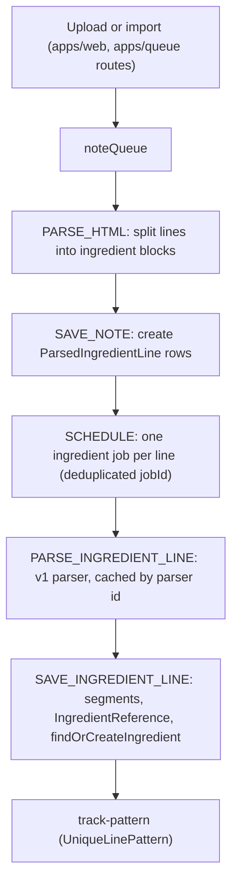
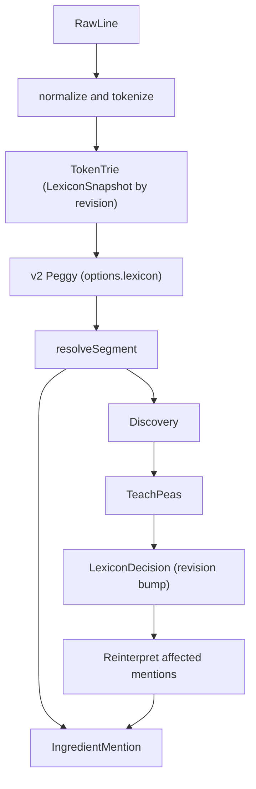

# Ingredient Parsing and Food Ontology Rebuild

Peas is moving to a Peggy-first, corpus-native, human-curated ingredient parser: a structural grammar (v2), a lexicon of typed roles fed into the grammar at parse time, a typed food ontology, and a review loop ("Teach Peas") that turns unknown or ambiguous expressions into reusable knowledge.

Related documents:

- [Prisma modernization decision](./prisma-modernization-decision.md)
- [Web modernization](./web-modernization.md)
- [Cache consistency](./cache-consistency.md)
- [Testing and coverage](../testing.md): every suite, how to run it, and the coverage floors
- [v2 parser guide](../../packages/parser/README.md): how the parser works, with worked example lines

## Phase 1 deliverables

Each item below can be seen or checked directly. Commands run from the repo root.

| # | Deliverable | How to see it |
| --- | --- | --- |
| 1 | **v2 parser explains any line.** Normalization, tokens, lexicon matches, and the syntax tree for one line. | `yarn workspace @peas/parser explain:line --lexicon demo "2 heaping cups all-purpose flour, sifted"` |
| 2 | **Unknown foods still parse.** Structure without any food knowledge. | `yarn workspace @peas/parser explain:line "3 tablespoons calamansi juice"` gives `[3 tbsp] calamansi juice` |
| 3 | **Exploratory mode previews proposed knowledge.** Two segmentations, with and without a proposed entry. | `yarn workspace @peas/parser explain:line --lexicon demo --exploratory "1 tbsp virgin olive oil"` |
| 4 | **The whole corpus parses.** At Phase 1 close, 682 of 682 exported lines parsed fully (v1: 681), in about 130 ms total versus about 70 ms per line for v1. The corpus was reset to empty on 12 November 2026 because that export included instruction text; after a fresh import, refill it and rerun the report. | `yarn workspace @peas/database export:lines`, then `yarn workspace @peas/parser corpus:baseline-v1` and `report:compare`; open `packages/parser/fixtures/reports/v1-vs-v2.md` |
| 5 | **Golden accuracy is measured, not guessed.** 182 dev cases (177 exact on quantity and phrase; 5 known failures documented) and 41 held-out cases. | Same report, "Golden sets" table |
| 6 | **Regression suite.** 272 tests: unit, golden, invariants (spans always point at raw text, parsing never throws), Zod schema round-trips, and a v1 snapshot. | `yarn workspace @peas/parser test:run` |
| 7 | **Lexicon change previews.** What changes across the corpus if an entry is added, before anyone accepts it. | `yarn workspace @peas/parser preview:lexicon --add "olive oil:FOOD"` |
| 8 | **Shared, documented schemas.** Zod schemas with worked examples for every tree node, exported from `@peas/parser/v2`. | `packages/parser/src/v2/ast/schemas.ts` |
| 9 | **Import bugs fixed.** Multi-block notes keep their `blockIndex`, re-saving a line replaces its ingredient references, parse-cache invalidation works, and ingredient jobs are deduplicated. | `yarn workspace @peas/queue test:run`; import a note with two ingredient lists and check the note page |
| 10 | **Migration history is trustworthy.** Drift baselined; the runtime-grammar tables dropped; all migrations replay cleanly on an empty database. | `SCRATCH_DATABASE_URL=... yarn workspace @peas/database db:verify-migrations` |
| 11 | **Legacy grammars unlinked but preserved.** The `/parser` rule builder and database grammar branch are gone; the old grammars and an export of the database rules are kept for reference. | `packages/parser/legacy/README.md` and `packages/parser/legacy/dynamic-archive/` |
| 12 | **Corpus export tool.** Refreshes the corpus from real imports. | `yarn workspace @peas/database export:lines` |

What Phase 1 deliberately does not deliver: imports still use v1 (v2 is wired in during Phase 5), no ontology tables exist yet (Phase 2), and nothing resolves a phrase to a food concept (Phase 3).

## Phase 2 deliverables

Phase 2 adds the storage the resolver and the review loop will write to. Nothing in the app reads or writes these tables yet; Phase 3 starts using them.

| # | Deliverable | How to see it |
| --- | --- | --- |
| 1 | **Ontology tables exist.** 21 models (concepts, lexicon entries, attributes, preparations, relationships, classifications, substitutions, products, mentions, discoveries, decisions, revisions, merge records, legacy mappings) in one additive migration. | `packages/database/prisma/schemas/ontology.prisma`; `yarn workspace @peas/database db:studio` |
| 2 | **The migration replays cleanly and matches the schema exactly**, including the pg_trgm extension, CHECK constraints, and the partial review-queue index. | `SCRATCH_DATABASE_URL=... yarn workspace @peas/database db:verify-migrations` |
| 3 | **Legacy pages are unaffected.** No legacy table or column changed; legacy queries run unchanged on the migrated database. | Start the app and open the notes, recipes, and ingredients pages |
| 4 | **The vocabulary seed is idempotent.** 11 attribute dimensions, 47 values, and 27 preparations; a second run adds nothing and leaves the revision alone. | `yarn workspace @peas/database db:seed:ontology` (twice) |
| 5 | **The database hands the parser a lexicon.** `getLexiconSnapshot()` returns UUID-keyed entries that `buildLexicon` accepts, so the parser can run on stored knowledge. | Integration test "builds snapshots the parser accepts" |
| 6 | **The hierarchy cannot loop.** IS_A and PART_OF edges that would create a cycle are rejected. | Integration test "rejects IS_A and PART_OF cycles" |
| 7 | **Classifications inherit by relationship type** (decision D15): buttermilk DERIVED_FROM milk inherits the milk allergen but not "dairy"; explicit values win. | `packages/parser/src/v2/ontology/inheritance.ts`; parser and integration tests |
| 8 | **Re-parsing never clobbers a person's work** (decision D17): mention upserts are idempotent, and verified mentions are protected; disagreements become VERIFIED_DRIFT discoveries. | Integration test "protects verified mentions" |
| 9 | **The review queue has real counts and priority** (decision D18): evidence across notes, the documented priority formula, cursor paging, and decisions that close discoveries with their own revision. | Integration test "counts evidence across notes" |
| 10 | **Every section-32 example is representable.** All 15 target interpretations in `golden/semantic.json` are stored as rows and read back unchanged. | `TEST_DATABASE_URL=... yarn workspace @peas/database test:int` |
| 11 | **Shared, documented payload schemas.** Resolution, discovery, and decision payloads (one variant per type), ontology enums, inheritance rules, vocabulary, and the priority formula, each with worked examples, exported from `@peas/parser/v2`. | `packages/parser/src/v2/{ontology,resolve,knowledge}/` |
| 12 | **Test suites.** Database unit tests (22, including a check that every Prisma enum matches its parser list) and integration tests (29) against a throwaway database; 16 new parser tests. | `yarn workspace @peas/database test:run`; `test:int` with `TEST_DATABASE_URL` |

What Phase 2 deliberately does not deliver: no resolver (Phase 3), no Teach Peas screens or decision side effects (Phase 4), no lexicon entries yet (the reviewed v1 descriptor seed lands in Phase 3), and no legacy ingredient migration (the mapping table exists; the migration runs later).

## Phase 3 deliverables

Phase 3 turns syntax into meaning: a pure resolver picks the food concept, attributes, preparations, and modifiers for each segment, and two seeds fill the ontology (reviewed modifiers from the v1 descriptor list, and concepts from legacy ingredients). Imports still use v1 until Phase 5.

| # | Deliverable | How to see it |
| --- | --- | --- |
| 1 | **Lines resolve to concepts.** `processIngredientLine` parses and resolves a line; each mention gets a status (AUTO_RESOLVED, NEEDS_REVIEW, UNRESOLVED), a score, and reasons such as `head:chicken thigh(2 tokens)`, `entry:PLURAL`, or `package:can->canned tomatoes`. | `packages/parser/src/v2/resolve/`; the parser README walks through examples |
| 2 | **Every section-32 example resolves as intended.** 15 of 15 semantic cases, including whole milk as its own concept, attributes only when they apply to the head, preparations with degree ("finely chopped"), cans implying canned tomatoes, and calamansi juice staying UNRESOLVED. | `yarn workspace @peas/parser test:run`; "Semantic precision" in `packages/parser/fixtures/reports/resolution.md` |
| 3 | **Behavior is stable under harmless edits.** Metamorphic tests: case, plurals, an added preparation, trailing notes, and removing an entry each change only what they should. | `src/v2/__tests__/process-line.metamorphic.test.ts` |
| 4 | **Coordination is handled.** "salt and pepper" splits into two parts (`partIndex`); "macaroni and cheese" stays one food when it is an entry; "milk or cream" becomes alternatives that need review. | `src/v2/__tests__/coordination.test.ts` |
| 5 | **A verified alias works without touching the grammar.** Adding an entry ("icing sugar", "stinking rose") changes resolution immediately. | Parser exploratory test and database integration test |
| 6 | **Reviewed modifier seed.** 99 entries (preparations, degrees, measurement modifiers, instructions, attributes) chosen from the 910-word v1 descriptor list; the rest are classified in a candidates file for later review. Idempotent. | `yarn workspace @peas/parser extract:descriptors`; `yarn workspace @peas/database db:seed:modifiers` (twice) |
| 7 | **Legacy ingredients seed the ontology without inventing hierarchy.** Three resumable passes keyed by `LegacyIngredientMapping`; parents become RELATIONSHIP_SUGGESTION discoveries, never IS_A edges; properties, categories, tags, substitutions, brands, and composed flags carry over. On the dev database: 10 legacy ingredients, 10 concepts, 10 mappings, 0 relationships; a second run changes nothing. | `yarn workspace @peas/database db:seed:legacy --dry-run`, then without `--dry-run` (twice) |
| 8 | **The database hands the resolver everything it needs.** `loadResolverSnapshot()` returns entries with targets, vocabulary, concepts, relationships, applicability, concept attributes, verified-choice priors, and the revision, as plain JSON for caching. | Integration test "feeds loadResolverSnapshot" |
| 9 | **Resolution is measured.** Coverage by status, top unresolved phrases, ambiguous lexemes, semantic precision, and coverage and precision at score thresholds 0.5, 0.7, and 0.9, from the fixture snapshot or the live database. | `yarn workspace @peas/parser evaluate:resolution`; `yarn workspace @peas/database db:evaluate:resolution` |
| 10 | **Test suites.** 49 new parser tests (resolver, metamorphic, coordination, exploratory, branches, report, seed file) and 8 new database integration tests; parser coverage 96.6% statements and 88.3% branches. | `yarn workspace @peas/parser test:coverage`; `TEST_DATABASE_URL=... yarn workspace @peas/database test:coverage` |

What Phase 3 deliberately does not deliver: no Teach Peas screens (Phase 4), no queue integration or mention writes during import (Phase 5), and no storage for coordination parts yet (mentions are keyed by `(parsedLineId, segmentIndex)`; Phase 5 adds `partIndex`). Legacy-seeded concepts for unreviewed ingredients are PROPOSED, so conservative imports ignore them until a reviewer promotes them.

## Where things stand (Phase 3)

| Area | State |
| --- | --- |
| v2 parser (`packages/parser/src/v2`) | Built: normalizer with raw-offset map, tokenizer, exact rationals, unit table, token trie with conservative and exploratory segmentation, Peggy grammar ported from v1, Zod schemas, `parseLine`. Lexicon entry ids must be UUIDs. |
| Shared ontology schemas (`@peas/parser/v2`) | Ontology enums, D15 inheritance rules, starting vocabulary, resolution, mention syntax, discovery, and decision payload schemas, D18 priority formula |
| Resolver (`@peas/parser/v2`, `src/v2/resolve/`) | `buildResolverContext` (snapshot to lexicon plus ontology view), `resolveSegment`, `scoreCandidate`, `processIngredientLine`, `buildResolutionReport`; `RESOLVER_VERSION` 1.0.0. Pure: no database access. |
| Ontology storage (`packages/database`) | 21 models in `prisma/schemas/ontology.prisma`, migration `20261112190000_add_food_ontology`, repositories in `src/repository/ontology/` (plus `loadResolverSnapshot`), vocabulary, modifier, and legacy seeds |
| Regression fixtures | Corpus (reset to empty on 12 November 2026; refilled from fresh imports with `export:lines`), 182 dev cases (5 known failures), 41 held-out cases, structural, demo, and semantic lexicons (the semantic lexicon now carries a small ontology), `modifiers.seed.json`, v1 descriptor candidates, v1 baseline and snapshot |
| Reports and tools | `report:compare` (v1 vs v2), `evaluate:resolution` and `db:evaluate:resolution` (resolution report), `preview:lexicon` (before/after preview of a lexicon change), `explain:line`, `extract:descriptors` |
| Import pipeline | Still parses with v1; v2 is not wired into the queue until Phase 5 |
| Legacy grammars | The old v2 stub and the runtime-compiled grammar moved to `packages/parser/legacy/` (reference only); database grammars archived and their tables dropped |
| Database | 42 migrations; `db:verify-migrations` replays them on a scratch database; integration tests run against `TEST_DATABASE_URL` |

## Ontology data model

The ontology separates what a food *is* from what it is *called* and from where it *appears*:


- **Concepts** are identities ("chicken thigh"). They have no name column beyond `canonicalName`; every way of writing them is a `LexiconEntry`.
- **Lexicon entries** say "this text plays this role and points at this target": a FOOD entry points at a concept, an ATTRIBUTE entry at an attribute value, a PREPARATION entry at an operation, and DEGREE, MEASUREMENT_MODIFIER, and INSTRUCTION entries at a value key such as `fine`. A CHECK constraint enforces that pairing. Entries are unique per `(matchKey, targetKey)`, so "green" can be both color=green and ripeness=unripe but not color=green twice.
- **Mentions** store one parsed segment each: the syntax tree, the quantity, the chosen concept, attributes, preparations, and modifiers, plus the versions that produced them (parser, normalizer, resolver, lexicon revision).
- **Discoveries** collect evidence (mentions) for something a reviewer should look at; **decisions** record what the reviewer chose, each with its own **revision**.
- Columns that point at legacy tables (`Recipe`, `Brand`, `IngredientTag`, `ParsedIngredientLine`, `User`) stay text because those tables use cuid ids. Every new table uses UUIDv7 ids stored as native `uuid` columns.
- The migration adds constraints Prisma cannot express (CHECK constraints, a partial index, the pg_trgm extension). `prisma db push` would drop them, which is another reason schema changes go through migrations only.

## Current architecture



- Raw lines are stored in `ParsedIngredientLine.reference`, keyed by `(noteId, blockIndex, lineIndex)`, so the corpus can always be reparsed.
- Legacy identity lives in `Ingredient` / `Alias` with a single-parent variant hierarchy and presence-means-true `IngredientProperty` rows.

## Target architecture



Everything up to and including the resolver is pure TypeScript in `packages/parser/src/v2` with no database access. Persistence lives in `packages/database`, jobs in `apps/queue`, and UI in the web app.

## Dependency map

Code that touches ingredient parsing or identity today:

- **Queue:** `parse-ingredient-line`, `save-ingredient-line`, `track-pattern`, `schedule-categorization`, `check-completion`, `parser-resolver.ts`, `cached-ingredient-parser.ts`.
- **Web:** `/ingredients` (`apps/web/src/lib/ingredients/actions`), `/notes/[id]` (`getNoteDetail`, `setIngredientLineReviewStatus`), `/recipes/[id]`. The `/parser` rule builder was removed in Phase 1.
- **Features:** `packages/features/src/{ingredients,notes,parsed-line}`.
- **Database:** `repository/{ingredient,note,parsing-rule,pattern}.ts` (legacy) and `repository/ontology/` (Phase 2: revision, lexicon, concepts, relationships, attributes, classifications, mentions, discoveries, decisions, legacy mapping; Phase 3: resolver snapshot). Seeds in `src/seed/` (vocabulary, modifiers, legacy ingredients).

## Design decisions

1. **v2 is a code-reviewed grammar.** Grammar changes go through pull requests with regression fixtures. Pre-v2 parsing can be retired at any time; old grammar files stay in `packages/parser/legacy/` as reference and are never built, exported, linted, tested, or imported.
2. **v2 is ported from v1, not rewritten.** Number, fraction, range, unit, and package rules were ported; descriptor and ingredient lists were dropped. The v1 descriptor list becomes the first modifier seed in Phase 3.
3. **The lexicon is fed into Peggy through parse options.** Matches come from an in-memory token trie keyed by start offset; the grammar consumes them with a predicate plus a function-boundary repetition. No database queries during parsing and no grammar regeneration when knowledge changes.
4. **One lexicon table with typed roles** (`FOOD`, `ATTRIBUTE`, `PREPARATION`, `DEGREE`, `MEASUREMENT_MODIFIER`, `INSTRUCTION`). One phrase may carry several entries; uniqueness is `(matchKey, targetKey)`, where `targetKey` is `food:<conceptId>`, `attr:<attributeValueId>`, `prep:<preparationId>`, or `<role>:<valueKey>`, and `matchKey` is `entryMatchKey(text)` (lowercased tokens joined by spaces). Phase 2 uses `matchKey` rather than the plan's `normalized` so that "Kosher Salt" and "kosher salt", which the parser matches identically, cannot be stored twice for the same target.
5. **Units are data in code** (`v2/quantity/units.ts`). Food parts ("thigh", "zest", "leaves") are lexicon entries, never units.
6. **Two parse modes.** `CONSERVATIVE` (imports) uses only active entries, leftmost-longest. `EXPLORATORY` (curation) also uses proposed entries and returns ranked alternative segmentations; skipping a match is only explored when it frees an overlapping match.
7. **An unknown food must still parse** ("3 tablespoons calamansi juice" gives `[3 tbsp] calamansi juice` with an empty lexicon). Permanent test.
8. **Knowledge changes bump a monotonic `LexiconRevision`**; every lexicon cache keys on it.
9. **Reinterpret and reparse share machinery.** A lexicon change reruns the (pure, fast) parse; a grammar change bumps `PARSER_VERSION`.
10. **Preparations record position (`PRE_HEAD` / `POST_HEAD`), not timing.**
11. **Plurals and variants are explicit entries**; the matcher has no morphology.
12. **Normalization is versioned and non-destructive** (`NORMALIZER_VERSION`): Unicode compatibility forms, vulgar fractions, dash, quote, and space variants. Case, hyphens, and words are preserved.
13. **Offsets are UTF-16 code units into the raw string, half-open.** The normalizer maps every normalized character back to its raw source; one tokenizer defines token boundaries for both the trie and the grammar.
14. **Concept promotion is a reviewed decision**, never a frequency threshold.
15. **Classification inheritance depends on relationship type** (config, computed at read time; explicit values win).
16. **Legacy fields get explicit destinations** (substitutions, composed ingredients, brands, categories, tags).
17. **Verified mentions are never overwritten automatically.**
18. **Review priority is a tested formula**; one decision applies to all of a discovery's evidence.
19. **Shared Zod schemas live in `@peas/parser/v2`.**
20. **Scale:** the full lexicon and corpus reinterpretation fit in memory; previews prefilter with a trigram index.
21. **Ontology ids are UUIDs.** New tables use UUIDv7 (time-ordered, index-friendly) stored as native `uuid`; lexicon entry ids must be UUIDs everywhere, including fixtures (`buildLexicon` rejects anything else). Legacy tables keep their cuid ids.
22. **Repository code stays portable.** Writes are flat, transaction-scoped statements (no nested `connectOrCreate` or atomic `increment`), unique violations are recognized only in `isUniqueViolation`, and every JSON column is validated with its Zod schema on write and read (`parseOrThrow`).
23. **The resolver reads one serializable snapshot.** `ResolverSnapshot` (entries with targets, vocabulary, concepts, relationships, applicability, concept attributes, priors, revision) is plain JSON, so the queue can cache it by revision and tests can build it from fixtures. The head is the rightmost FOOD lexeme in the main phrase; other lexemes take a role by priority (an attribute that applies to the head, then preparation, degree, measurement modifier, instruction, then an attribute that does not apply, then an extra food). Attributes apply through the head's own and IS_A/PART_OF ancestors' applicability.
24. **Auto-resolution needs a single, fully explained reading.** Any unknown word in the main phrase, an attribute that does not apply, an ambiguous lexeme, a second food, or an "or" alternative sends the mention to review. Unknown words in trailing text or parentheses are notes and do not block. A line with no recognized food is UNRESOLVED with its unknown spans recorded.
25. **Packages can imply a concept.** A quantity in cans or tins picks the head's single canned descendant (through IS_A, PROCESSED_FROM, or DERIVED_FROM with `preservation=canned`), so "2 cans tomatoes" resolves to canned tomatoes.
26. **Legacy hierarchy is evidence, not truth.** The legacy seed never writes relationships; `parentIngredientId` becomes a RELATIONSHIP_SUGGESTION with a guessed type (PART_OF when the child names a part such as "thigh" or "zest", otherwise IS_A) for a reviewer to accept.

## Quantity model

`Quantity` is a discriminated union: `EXACT` (optionally `implied`, as in "pinch of salt"), `RANGE`, `APPROXIMATE`, `PACKAGE` (count, optional package type, optional package size), `ALTERNATIVE`, `SUM`, and `UNSPECIFIED` ("to taste", "as needed", "some", "a few", "several"). Values are reduced rationals, never floats.

## Known structural gaps

Recorded as known failures in `fixtures/golden/structural.dev.json` or observed in the comparison report:

- Size words before a unit ("1 small bunch", "small handful") are not measurement modifiers. Size attributes exist since Phase 3, but this needs a grammar change (Phase 6).
- Ranges whose ends use different units ("800g–1kg") are not representable.
- Postfix unspecified quantities with a unit ("rosemary a few sprigs").
- "recipe", "rack", "slab" are not units.

## Verification commands

```bash
yarn workspace @peas/parser test:run          # v2 unit, golden, invariant, schema, v1 baseline tests
yarn workspace @peas/parser typecheck
yarn workspace @peas/parser report:compare    # writes fixtures/reports/v1-vs-v2.md
yarn workspace @peas/parser preview:lexicon --add "olive oil:FOOD"
yarn workspace @peas/parser evaluate:resolution  # writes fixtures/reports/resolution.md
yarn workspace @peas/parser extract:descriptors  # writes fixtures/lexicon/v1-descriptors.candidates.json
yarn workspace @peas/database export:lines --log ../../apps/queue/logs/<file>
SCRATCH_DATABASE_URL=... yarn workspace @peas/database db:verify-migrations
yarn workspace @peas/database typecheck
yarn workspace @peas/database test:run        # ontology helpers and Prisma/parser enum parity
TEST_DATABASE_URL=postgresql://<you>@localhost:5432/peas_test yarn workspace @peas/database test:int
yarn workspace @peas/database db:seed:ontology
yarn workspace @peas/database db:seed:modifiers
yarn workspace @peas/database db:seed:legacy --dry-run   # then without --dry-run; --batch 200 by default
yarn workspace @peas/database db:evaluate:resolution     # live-database report, read-only
```

The integration setup wipes and migrates `TEST_DATABASE_URL` before running, and refuses to touch a database whose name lacks "test" or that matches `DATABASE_URL`. Create it once with `createdb peas_test`.

## Roadmap and modernization

The v2 phases (1 foundation, 2 ontology schema, 3 lexicon and resolver, 4 Teach Peas, 5 cutover, 6 grammar evolution, 7 legacy cleanup) are amended by a modernization workstream that runs between Phase 1 and the ontology work:

1. Stabilize Phase 1 (this document). Done.
2. M1: Prisma 8 feasibility proof of concept and decision. Done: Prisma 7.
3. M2: Prisma migration, before any new ontology repositories (Phase 2). Done in the working tree (Prisma 7.10.1 with the `pg` adapter).
4. M3: TypeScript and Vite/Vitest upgrades in isolated groups. Done in the working tree (TypeScript 6.0.3, Vitest 5.1, Vite 8.3; see the web modernization record).
5. M4: Next.js to TanStack Start; GraphQL with Apollo Client 4 (see [web modernization](./web-modernization.md)). Done on 12 November 2026, including cutover: the TanStack Start app is now `apps/web` (port 3100), serving every page through `packages/api`, with Playwright and axe tests; the Next.js app was deleted.
6. M5: cache architecture (see [cache consistency](./cache-consistency.md)). Done on 12 November 2026 for today's domains; the knowledge domains join when Phases 3 and 4 add their queries.
7. Phase 2 (ontology schema): done on 12 November 2026, ahead of finishing M4 because it only touches `packages/database` and `packages/parser`.
8. Phase 3 (lexicon-driven resolver and ontology seeding): done on 12 November 2026.
9. Phases 4-7 continue on the modernized stack.
10. Deferred: BullMQ 6, Redis client, Storybook 10, virtualization.

Framework-independent parsing logic stays in `packages/parser` throughout.
