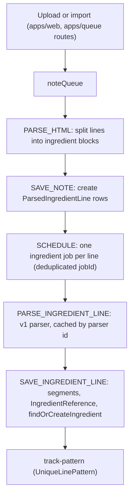
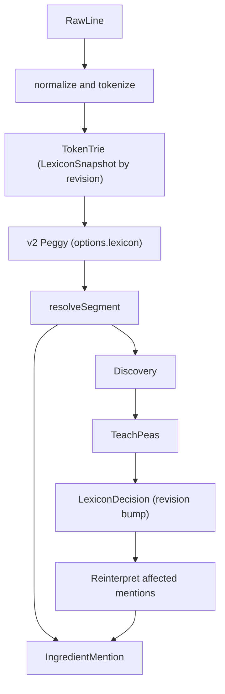

# Ingredient Parsing and Food Ontology Rebuild

Peas is moving to a Peggy-first, corpus-native, human-curated ingredient parser: a structural grammar (v2), a lexicon of typed roles fed into the grammar at parse time, a typed food ontology, and a review loop ("Teach Peas") that turns unknown or ambiguous expressions into reusable knowledge.

Related documents:

- [Prisma modernization decision](./prisma-modernization-decision.md)
- [Web modernization](./web-modernization.md)
- [Cache consistency](./cache-consistency.md)
- [v2 parser guide](../../packages/parser/README.md): how the parser works, with worked example lines

## Phase 1 deliverables

Each item below can be seen or checked directly. Commands run from the repo root.

| # | Deliverable | How to see it |
| --- | --- | --- |
| 1 | **v2 parser explains any line.** Normalization, tokens, lexicon matches, and the syntax tree for one line. | `yarn workspace @peas/parser explain:line --lexicon demo "2 heaping cups all-purpose flour, sifted"` |
| 2 | **Unknown foods still parse.** Structure without any food knowledge. | `yarn workspace @peas/parser explain:line "3 tablespoons calamansi juice"` gives `[3 tbsp] calamansi juice` |
| 3 | **Exploratory mode previews proposed knowledge.** Two segmentations, with and without a proposed entry. | `yarn workspace @peas/parser explain:line --lexicon demo --exploratory "1 tbsp virgin olive oil"` |
| 4 | **The whole corpus parses.** At Phase 1 close, 682 of 682 exported lines parsed fully (v1: 681), in about 130 ms total versus about 70 ms per line for v1. The corpus was reset to empty on 12 November 2026 because that export included instruction text; after a fresh import, refill it and rerun the report. | `yarn workspace @peas/database export:lines`, then `yarn workspace @peas/parser corpus:baseline-v1` and `report:compare`; open `packages/parser/fixtures/reports/v1-vs-v2.md` |
| 5 | **Golden accuracy is measured, not guessed.** 182 dev cases (177 exact on quantity and phrase; 5 known failures documented) and 41 held-out cases. | Same report, "Golden sets" table |
| 6 | **Regression suite.** 272 tests: unit, golden, invariants (spans always point at raw text, parsing never throws), Zod schema round-trips, and a v1 snapshot. | `yarn workspace @peas/parser test:run` |
| 7 | **Lexicon change previews.** What changes across the corpus if an entry is added, before anyone accepts it. | `yarn workspace @peas/parser preview:lexicon --add "olive oil:FOOD"` |
| 8 | **Shared, documented schemas.** Zod schemas with worked examples for every tree node, exported from `@peas/parser/v2`. | `packages/parser/src/v2/ast/schemas.ts` |
| 9 | **Import bugs fixed.** Multi-block notes keep their `blockIndex`, re-saving a line replaces its ingredient references, parse-cache invalidation works, and ingredient jobs are deduplicated. | `yarn workspace @peas/queue test:run`; import a note with two ingredient lists and check the note page |
| 10 | **Migration history is trustworthy.** Drift baselined; the runtime-grammar tables dropped; all migrations replay cleanly on an empty database. | `SCRATCH_DATABASE_URL=... yarn workspace @peas/database db:verify-migrations` |
| 11 | **Legacy grammars unlinked but preserved.** The `/parser` rule builder and database grammar branch are gone; the old grammars and an export of the database rules are kept for reference. | `packages/parser/legacy/README.md` and `packages/parser/legacy/dynamic-archive/` |
| 12 | **Corpus export tool.** Refreshes the corpus from real imports. | `yarn workspace @peas/database export:lines` |

What Phase 1 deliberately does not deliver: imports still use v1 (v2 is wired in during Phase 5), no ontology tables exist yet (Phase 2), and nothing resolves a phrase to a food concept (Phase 3).

## Where things stand (Phase 1)

| Area | State |
| --- | --- |
| v2 parser (`packages/parser/src/v2`) | Built: normalizer with raw-offset map, tokenizer, exact rationals, unit table, token trie with conservative and exploratory segmentation, Peggy grammar ported from v1, Zod schemas, `parseLine` |
| Regression fixtures | Corpus (reset to empty on 12 November 2026; refilled from fresh imports with `export:lines`), 182 dev cases (5 known failures), 41 held-out cases, structural lexicon, v1 baseline and snapshot |
| Reports and tools | `report:compare` (v1 vs v2), `preview:lexicon` (before/after preview of a lexicon change) |
| Import pipeline | Still parses with v1; v2 is not wired into the queue until Phase 5 |
| Legacy grammars | The old v2 stub and the runtime-compiled grammar moved to `packages/parser/legacy/` (reference only); database grammars archived and their tables dropped |
| Database | Migration history baselined; `db:verify-migrations` replays migrations on a scratch database |

## Current architecture



- Raw lines are stored in `ParsedIngredientLine.reference`, keyed by `(noteId, blockIndex, lineIndex)`, so the corpus can always be reparsed.
- Legacy identity lives in `Ingredient` / `Alias` with a single-parent variant hierarchy and presence-means-true `IngredientProperty` rows.

## Target architecture



Everything up to and including the resolver is pure TypeScript in `packages/parser/src/v2` with no database access. Persistence lives in `packages/database`, jobs in `apps/queue`, and UI in the web app.

## Dependency map

Code that touches ingredient parsing or identity today:

- **Queue:** `parse-ingredient-line`, `save-ingredient-line`, `track-pattern`, `schedule-categorization`, `check-completion`, `parser-resolver.ts`, `cached-ingredient-parser.ts`.
- **Web:** `/ingredients` (`apps/web/src/lib/ingredients/actions`), `/notes/[id]` (`getNoteDetail`, `setIngredientLineReviewStatus`), `/recipes/[id]`. The `/parser` rule builder was removed in Phase 1.
- **Features:** `packages/features/src/{ingredients,notes,parsed-line}`.
- **Database:** `repository/{ingredient,note,parsing-rule,pattern}.ts`.

## Design decisions

1. **v2 is a code-reviewed grammar.** Grammar changes go through pull requests with regression fixtures. Pre-v2 parsing can be retired at any time; old grammar files stay in `packages/parser/legacy/` as reference and are never built, exported, linted, tested, or imported.
2. **v2 is ported from v1, not rewritten.** Number, fraction, range, unit, and package rules were ported; descriptor and ingredient lists were dropped. The v1 descriptor list becomes the first modifier seed in Phase 3.
3. **The lexicon is fed into Peggy through parse options.** Matches come from an in-memory token trie keyed by start offset; the grammar consumes them with a predicate plus a function-boundary repetition. No database queries during parsing and no grammar regeneration when knowledge changes.
4. **One lexicon table with typed roles** (`FOOD`, `ATTRIBUTE`, `PREPARATION`, `DEGREE`, `MEASUREMENT_MODIFIER`, `INSTRUCTION`). One phrase may carry several entries; uniqueness uses a computed `targetKey`.
5. **Units are data in code** (`v2/quantity/units.ts`). Food parts ("thigh", "zest", "leaves") are lexicon entries, never units.
6. **Two parse modes.** `CONSERVATIVE` (imports) uses only active entries, leftmost-longest. `EXPLORATORY` (curation) also uses proposed entries and returns ranked alternative segmentations; skipping a match is only explored when it frees an overlapping match.
7. **An unknown food must still parse** ("3 tablespoons calamansi juice" gives `[3 tbsp] calamansi juice` with an empty lexicon). Permanent test.
8. **Knowledge changes bump a monotonic `LexiconRevision`**; every lexicon cache keys on it.
9. **Reinterpret and reparse share machinery.** A lexicon change reruns the (pure, fast) parse; a grammar change bumps `PARSER_VERSION`.
10. **Preparations record position (`PRE_HEAD` / `POST_HEAD`), not timing.**
11. **Plurals and variants are explicit entries**; the matcher has no morphology.
12. **Normalization is versioned and non-destructive** (`NORMALIZER_VERSION`): Unicode compatibility forms, vulgar fractions, dash, quote, and space variants. Case, hyphens, and words are preserved.
13. **Offsets are UTF-16 code units into the raw string, half-open.** The normalizer maps every normalized character back to its raw source; one tokenizer defines token boundaries for both the trie and the grammar.
14. **Concept promotion is a reviewed decision**, never a frequency threshold.
15. **Classification inheritance depends on relationship type** (config, computed at read time; explicit values win).
16. **Legacy fields get explicit destinations** (substitutions, composed ingredients, brands, categories, tags).
17. **Verified mentions are never overwritten automatically.**
18. **Review priority is a tested formula**; one decision applies to all of a discovery's evidence.
19. **Shared Zod schemas live in `@peas/parser/v2`.**
20. **Scale:** the full lexicon and corpus reinterpretation fit in memory; previews prefilter with a trigram index.

## Quantity model

`Quantity` is a discriminated union: `EXACT` (optionally `implied`, as in "pinch of salt"), `RANGE`, `APPROXIMATE`, `PACKAGE` (count, optional package type, optional package size), `ALTERNATIVE`, `SUM`, and `UNSPECIFIED` ("to taste", "as needed", "some", "a few", "several"). Values are reduced rationals, never floats.

## Known structural gaps

Recorded as known failures in `fixtures/golden/structural.dev.json` or observed in the comparison report:

- Size words before a unit ("1 small bunch", "small handful") are not measurement modifiers; resolved once size attributes exist (Phase 3).
- Ranges whose ends use different units ("800g–1kg") are not representable.
- Postfix unspecified quantities with a unit ("rosemary a few sprigs").
- "recipe", "rack", "slab" are not units.

## Verification commands

```bash
yarn workspace @peas/parser test:run          # v2 unit, golden, invariant, schema, v1 baseline tests
yarn workspace @peas/parser typecheck
yarn workspace @peas/parser report:compare    # writes fixtures/reports/v1-vs-v2.md
yarn workspace @peas/parser preview:lexicon --add "olive oil:FOOD"
yarn workspace @peas/database export:lines --log ../../apps/queue/logs/<file>
SCRATCH_DATABASE_URL=... yarn workspace @peas/database db:verify-migrations
```

## Roadmap and modernization

The v2 phases (1 foundation, 2 ontology schema, 3 lexicon and resolver, 4 Teach Peas, 5 cutover, 6 grammar evolution, 7 legacy cleanup) are amended by a modernization workstream that runs between Phase 1 and the ontology work:

1. Stabilize Phase 1 (this document). Done.
2. M1: Prisma 8 feasibility proof of concept and decision. Done: Prisma 7.
3. M2: Prisma migration, before any new ontology repositories (Phase 2). Done in the working tree (Prisma 7.10.1 with the `pg` adapter).
4. M3: TypeScript and Vite/Vitest upgrades in isolated groups. Done in the working tree (TypeScript 6.0.3, Vitest 5.1, Vite 8.3; see the web modernization record).
5. M4: Next.js to TanStack Start; GraphQL with Apollo Client 4 (see [web modernization](./web-modernization.md) for the open question that GraphQL does not exist in the repo today).
6. M5: cache architecture (see [cache consistency](./cache-consistency.md)).
7. Phases 2-7 continue on the modernized stack.
8. Deferred: BullMQ 6, Redis client, Storybook 10, virtualization.

Framework-independent parsing logic stays in `packages/parser` throughout.
