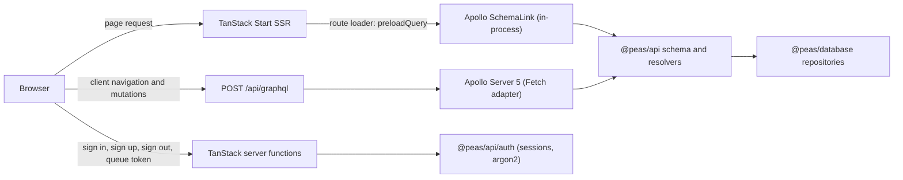

# Web Modernization (Next.js to TanStack Start, GraphQL with Apollo Client 4)

Status (12 November 2026): M3, M4, and M5 done. The TanStack Start app replaced the Next.js app the same day: it was built as `apps/web-start`, validated with a real import, and then renamed to `apps/web` (package `@peas/web`) when the Next.js app was deleted (see the [M4 record](#m4-record-12-november-2026)). Cache work is recorded in [cache consistency](./cache-consistency.md). The rest of this document keeps the pre-migration audit for reference.

## Headline finding: GraphQL does not exist today

The amendment assumes GraphQL and Apollo are retained. They are not present:

- No workspace depends on `graphql`, `@apollo/*`, `graphql-yoga`, `urql`, or `@graphql-codegen/*`; there are no `.graphql` files, `gql` tags, or codegen configs. `graphql@16.11.0` appears only as a transitive dependency of `msw`.
- The web app reads data in async server components that call `@peas/database` directly (5 pages) and writes through 9 server-action files (14 actions). There are no route handlers.

Adopting GraphQL is therefore **new work**: a schema, a server, resolvers over the domain services, codegen, and an Apollo client. That is compatible with the target architecture but changes the size of M4. See "Decisions needed".

## Current stack

| Concern | Today |
| --- | --- |
| Framework | Next.js 15.4.2, React 19.1.1, App Router |
| Data reads | Server components importing `@peas/database` (notes, notes detail, recipes, recipe detail, ingredients) |
| Data writes | Server actions (`"use server"`) passed as props into `@peas/features` page components and run through `useMutation` (`useTransition`); forms use `useActionState` / `useFormStatus` |
| Cache invalidation | `revalidatePath` (9 calls in 3 files) |
| Auth | Hand-rolled Lucia-style sessions: SHA-256 hashed tokens in the `Session` table, `session` cookie via `next/headers`, argon2 passwords, invite codes from `SIGN_UP_CODES` |
| Queue access | Browser calls the queue directly (upload `fetch` with a 5-minute HMAC token from the `getQueueToken` server action; WebSocket with `?token=`) |
| Shared UI | `@peas/features` and `@peas/components`: **no `next/*` imports**; navigation is injected through `AppNavigationProvider({ LinkComponent, push })` |
| Storybook | `@storybook/react-vite` 8.6.14 (already Vite-based) |
| E2E | Playwright 1.55 with `@axe-core/playwright`, `webServer: yarn dev` on port 3000 |
| Deployment | `railway.toml` (nixpacks, `yarn workspace @peas/web start`); no deploy config for the queue; no CI workflows |

## Next.js-specific surface to replace

| API | Count | Where |
| --- | --- | --- |
| `redirect` | 10 calls in 7 files | auth helpers and actions, invite page |
| `notFound` | 2 | notes and recipe detail pages |
| `usePathname`, `useRouter` | 1 file | `lib/auth/components/authenticated-layout.tsx` |
| `next/link` | 2 files | authenticated layout, `app/error.tsx` |
| `next/headers` `cookies()` | 2 files | `get-auth.ts`, `session-cookie.ts` |
| `next/font/google` | 1 | root layout (Source Sans 3) |
| `revalidatePath` | 9 calls, 3 files | recipe, ingredient, and line-review actions |
| `"use server"` | 9 files | listed in the audit |
| `import "server-only"` | 4 files | session, auth, queue token, avatar |
| `export const dynamic = "force-dynamic"` | 9 files | protected layout and data pages |
| `NEXT_PUBLIC_*` reads | `@peas/features` (upload endpoint, WebSocket URL/host/port) | must move to `import.meta.env.VITE_*` or a build-time define |
| Config | `transpilePackages`, `serverActions.bodySizeLimit: 50mb`, `next/core-web-vitals` ESLint, `nextjs.json` tsconfig | |

Routes to migrate: `/login`, `/invite/:code`, `/password-reset`, and the protected group (`/`, `/import`, `/notes`, `/notes/:id`, `/recipes`, `/recipes/:id`, `/ingredients`, `/design`), plus root `loading`, `error`, and `not-found` boundaries.

## Migration plan (M4)

1. **GraphQL server and schema.** Host the server in a TanStack Start server route (see decisions) and define the schema over domain services in `packages/database` (later, ontology services). Prisma types never become the GraphQL contract.
2. **New app.** Scaffold `apps/web` (TanStack Start + TanStack Router) alongside `apps/web`, reusing `@peas/features`, `@peas/components`, `@peas/theme`, `@peas/tailwind`. Inject TanStack Router's `Link` and `navigate` through `AppNavigationProvider`.
3. **Apollo Client 4.** Request-scoped clients on the server, cache restoration on hydration, type policies keyed by immutable ids, and session isolation between users.
4. **Codegen.** GraphQL Code Generator with stable fragments for FoodConcept, FoodTerm, IngredientMention, KnowledgeProposal, KnowledgeDecision, Recipe, and ImportJob.
5. **Auth.** Port session validation to TanStack Start server functions or middleware (cookie read/write without `next/headers`); keep the session table, token hashing, and argon2 unchanged. The GraphQL context resolves the user from the same cookie.
6. **Representative slice first:** notes list and note detail (query, the line-review mutation, routing, loading and error states, cache behavior, Playwright + axe test). Then migrate the remaining routes.
7. **Env and assets.** Replace `NEXT_PUBLIC_*` with `VITE_*`; replace `next/font` with `@fontsource` (Storybook already uses it).
8. **Cutover.** Point Playwright and `railway.toml` at the new app; remove Next.js dependencies and config only after it is stable. Never combine the cutover with a destructive ontology migration.

### M4 implementation notes (researched 12 November 2026)

**TanStack Start 1.169 (first stable release):**
- Requires Vite 8, which the repo already has. Path aliases use Vite's native `resolve.tsconfigPaths: true`; `vite-tsconfig-paths` is not needed.
- Server functions use `.validator()` (renamed from `.inputValidator()`). `useSession`/`getSession` were removed, so sessions use `getCookie`/`setCookie`/`deleteCookie` from `@tanstack/react-start/server` with the existing session table.
- `setResponseHeader("set-cookie", …)` replaces every outgoing cookie; use `setCookie` instead.
- Server routes are `createFileRoute("/api/graphql")({ server: { handlers: { GET, POST } } })`. Automatic CSRF protection covers server functions only, so the GraphQL route relies on Apollo Server's CSRF prevention, which is on by default. Adding a `src/start.ts` removes the automatic server-function CSRF middleware unless `createCsrfMiddleware()` is added back explicitly.
- Production runs through the `nitro()` Vite plugin (`node .output/server/index.mjs`). The built server does not read `.env` files.
- Client code only sees `import.meta.env.VITE_*`. Two shared files read `process.env.NEXT_PUBLIC_*` (`packages/features/src/utils/websocket-config.ts` and `packages/features/src/import/services/upload-service.ts`); switch them to injected values or `VITE_*`.

**Apollo Server 5.5:**
- Requires `graphql ^16.11` (npm `latest` is 17.1, so pin 16 across the whole monorepo; two copies break at runtime).
- There is no Fetch-API integration (`@as-integrations/fetch` does not exist; `@as-integrations/next` needs `next` and mishandles `application/json; charset=utf-8`). `@peas/api` ships its own small adapter around `executeHTTPGraphQLRequest`, started with `startInBackgroundHandlingStartupErrorsByLoggingAndFailingAllRequests()`. It passes `body: undefined` for non-JSON POSTs so Apollo's CSRF check rejects them.
- Set `introspection`, stack traces, and the landing page explicitly instead of relying on `NODE_ENV`.
- Resolver tests use `server.executeOperation(…, { contextValue })` without starting the server.

**GraphQL Code Generator 8 (released 7 November 2026, Node 22.18 or newer):**
- Server: `typescript` + `typescript-resolvers` with `useIndexSignature: true`, `contextType`, `useTypeImports`, and `enumsAsTypes`.
- Client: Apollo recommends `typescript-operations` (optionally with `typed-document-node`) over `client-preset`; if the preset is used, set `fragmentMasking: false`, `nonOptionalTypename: true`, `skipTypeNameForRoot: true`, and `enumType: "string-literal"` (the preset ignores `enumsAsTypes`). Nullable fields generate as `T | null`, not optional.
- CLI 8 picks up `#graphql`-tagged strings by default, so client `documents` globs stay scoped to the web app.

**Apollo Client 4.3 with SSR:**
- Hooks come from `@apollo/client/react`; `rxjs` is a required peer; `HttpLink` must be passed explicitly; `ApolloError` is gone (use `CombinedGraphQLErrors.is` / `ServerError.is`); `useQuery` has no `onCompleted`/`onError`; use `skipToken` instead of `skip`.
- `client.refetchQueries({ updateCache(cache) { cache.evict(…) } })` refetches every active query affected by the eviction, which is the mechanism the M5 cache coordinator uses.
- `@apollo/client-integration-tanstack-start` is still a release candidate (`0.14.5-rc.0`). It is tested by Apollo against Start 1.132 and Vite 7, not 1.169 and Vite 8, and has an open Safari/WebKit hydration crash ([#559](https://github.com/apollographql/apollo-client-integrations/issues/559), fix in unmerged [PR #574](https://github.com/apollographql/apollo-client-integrations/pull/574)). Plan: build the notes slice on it, test Safari first, and apply the PR as a `yarn patch` if it still crashes. If the integration does not work on 1.169, fall back to route loaders that call server functions plus client-only Apollo hydration from the loader data.
- `ApolloClient` and `InMemoryCache` must be imported from the integration package, created inside `getRouter()` (one per request on the server). During SSR the GraphQL server runs in the same process, so the server branch can use `SchemaLink` with the viewer resolved from the request cookie instead of an HTTP round trip.

## M4 record, 12 November 2026

The app lives in `apps/web` (TanStack Start 1.169.5, TanStack Router 1.170, Vite 8.3, Apollo Client 4.3) and talks to `packages/api` (Apollo Server 5.5, GraphQL 16.15). It runs on port 3100 in development. The Next.js app it replaced was deleted after cutover; the route map below records where each Next.js page went.

### How a request flows



- **Server rendering** runs GraphQL in-process through Apollo's `SchemaLink` with the viewer resolved from the request's session cookie, so there is no HTTP hop to itself and no internal URL to configure. The browser uses `HttpLink` to `/api/graphql` with the same cookie.
- **Route loaders** call `preloadQuery`; components read with `useReadQuery`. The default fetch policy is `cache-and-network`, so every navigation renders cached data at once and refreshes it (imports change data in the background, and the Next app was always fresh).
- **Mutations** go through `useMutationAction`, which adapts a GraphQL mutation to the `MutationAction` signature the `@peas/features` components already use and hands every `MutationEffect` to the M5 cache coordinator. Feature components did not change, apart from widening `ParsedLineSegment.rule` / `ingredientId` to accept `null`.
- **Auth** stays the same scheme (hashed session tokens in `Session`, the `session` cookie, argon2, invite codes). The core moved to `@peas/api/auth`; cookies are read and written by TanStack server functions (`apps/web/src/server/auth.functions.ts`). `getViewerFn` also re-sends the cookie so a session extended by `validateSession` keeps its new expiry, which Next could not do from a server component.
- **Navigation** for feature components comes from `RouterNavigationProvider`: a real anchor that routes plain clicks through TanStack Router (`navigate({ href })`) and preloads on hover.

### Route map

| Next.js (deleted) | TanStack Start (`apps/web`) | Data |
| --- | --- | --- |
| `app/(protected)/layout.tsx` | `routes/_authed.tsx` (`beforeLoad` redirects to `/login`) | `getViewerFn` |
| `app/(protected)/page.tsx` | `routes/_authed/index.tsx` | `CleanupAllData` mutation (admins) |
| `app/(protected)/notes/page.tsx` | `routes/_authed/notes/index.tsx` | `NotesPage` query |
| `app/(protected)/notes/[id]/page.tsx` | `routes/_authed/notes/$id.tsx` | `NoteDetail`, `SetLineReviewStatus`, `PromoteNoteToRecipe` |
| `app/(protected)/recipes/page.tsx` | `routes/_authed/recipes/index.tsx` | `RecipesPage`, `PromoteCompletedNotes` |
| `app/(protected)/recipes/[id]/page.tsx` | `routes/_authed/recipes/$id.tsx` | `RecipeDetail`, `UpdateRecipe` |
| `app/(protected)/ingredients/page.tsx` | `routes/_authed/ingredients.tsx` | `IngredientsPage`, `IngredientDetail`, `SearchIngredients`, `SaveIngredient`, `CreateIngredient` |
| `app/(protected)/import/page.tsx` | `routes/_authed/import.tsx` | `ImportStats`, `getQueueTokenFn` |
| `app/(protected)/design/page.tsx` | `routes/_authed/design.tsx` | none |
| `app/login`, `app/invite/[code]`, `app/password-reset` | `routes/login.tsx`, `routes/invite.$code.tsx`, `routes/password-reset.tsx` | `loginFn`, `signUpFn`, `checkInviteFn` |
| `error.tsx`, `not-found.tsx`, `loading.tsx` | Router `defaultErrorComponent`, `defaultNotFoundComponent`, `defaultPendingComponent` (`components/route-states.tsx`) | none |
| 14 server actions, 9 `revalidatePath` calls | 9 GraphQL mutations plus 5 server functions; cache updates through mutation effects | none |

### What was verified

- `@peas/api`: 23 tests (server operations through `executeOperation` with the database mocked, the Fetch adapter including CSRF rejection, the effect contract against the schema enum, auth helpers).
- `apps/web`: typecheck, lint, 7 cache-coordinator tests, and 14 Playwright tests in Chromium and WebKit (sign-in redirect and errors, sign out, notes list filtering, note detail line review surviving a reload, and axe WCAG 2.1 AA scans of the login, notes list, and note detail pages).
- Production build: `vite build` with Nitro succeeds; the client bundle contains no Prisma, Apollo Server, argon2, schema, or connection-string code; `node .output/server/index.mjs` serves pages and GraphQL, and the Apollo Sandbox is off in production.
- Manually in the browser: sign in, notes filters, note review, promoting notes to recipes (the list refetches by itself), and renaming a recipe (the open detail refetches by itself).

### Problems found and fixed along the way

- **Interface fragments need `possibleTypes`.** Without them Apollo silently dropped `success` and `effect` from every mutation payload. `possibleTypes` is now generated from the schema (`src/graphql/possible-types.ts`).
- **`PORT` from `.env.local` (the queue's 4200) overrides Vite's port** under the Start/Nitro plugin. The app's scripts pin `PORT=3100`.
- **Database error text leaked to the browser** in failure payloads (the Next actions did the same). Prisma errors now map to plain messages and are logged server-side.
- **The login form never showed "Incorrect email or password"**: the shared `Form` only logs `actionState.message`. The new forms render it as an alert.
- **Colour contrast:** parsed-line comment, separator, and pending text failed WCAG AA (`greyscale-400/500` on white). They now use `greyscale-600` in the shared components.
- **Hydration race in tests:** clicks on server-rendered markup before hydration were lost. The root sets `<html data-hydrated>` and tests wait for it.

### Running it

```bash
yarn workspace @peas/web dev            # http://localhost:3100 (also starts with the root `yarn dev`)
yarn workspace @peas/web codegen        # after editing src/graphql/operations or the API schema
yarn workspace @peas/api codegen              # after editing packages/api/src/schema/schema.graphql
TEST_DATABASE_URL=postgresql://<you>@localhost:5432/peas_test yarn workspace @peas/web test:e2e
```

The import page talks to the queue from the browser, so the queue must allow the new origin: add `http://localhost:3100` to `CORS_ALLOWED_ORIGINS` in `.env.local` (comma-separated) and restart the queue.

### Cutover, 12 November 2026

- [x] Real import end to end from the new app on port 3100 (with `http://localhost:3100` added to `CORS_ALLOWED_ORIGINS`).
- [x] Next.js app deleted; `apps/web-start` renamed to `apps/web` and `@peas/web-start` to `@peas/web`. `railway.toml` already starts `@peas/web`; the start script honours the host's `PORT` (Nitro does not read `.env` files in production, so set real environment variables there).
- [x] `SIGN_UP_CODES.md` moved into `apps/web`; the Tailwind reload hook now touches `apps/web/src/styles/app.css`.
- [ ] Check desktop Safari once (Playwright's WebKit passed; Apollo's TanStack integration is still a release candidate with an open Safari report, [#559](https://github.com/apollographql/apollo-client-integrations/issues/559)).
- [x] Rewrote the deleted Next.js Playwright suites for import, ingredients, and recipes against the new app, now with seeded data instead of skips (38 tests across Chromium and WebKit; see [testing](../testing.md)).
- [ ] Move ESLint to 10 and `eslint-plugin-react-hooks` to 7 (deferred in M3 until Next.js was gone; now unblocked).

## Tooling (M3) record, 12 November 2026

### Group A: TypeScript

| Field | Value |
| --- | --- |
| Previous | TypeScript 5.9.2 (declared ^5.8.3) |
| New | TypeScript 6.0.3 in every workspace; the codebase also typechecks cleanly with TypeScript 7.0.2 |
| Why not 7 now | TypeScript 7.0 ships no JavaScript API (planned for 7.1). typescript-eslint, Next.js type checking, tsup declarations, and ts-node need it. Microsoft's side-by-side setup (`typescript` aliased to `@typescript/typescript6`) fails under Yarn 4, which force-applies its built-in `typescript` patch to the alias; installing both majors also collides on the `tsc` binary. |
| TS 7 speed (typecheck, local) | queue 5.8 s → 1.0 s; features 2.1 s → 0.2 s; database 1.9 s → 0.3 s; parser 1.0 s → 0.2 s |
| Breaking changes handled | `baseUrl` removed from `react-library.json`, components, features, web (paths are relative to each tsconfig); web's bare `src/paths` import made relative; web gained `src/css.d.ts` for side-effect CSS imports; features lists `types: ["node"]` (6.0 defaults `types` to empty) |
| Related | typescript-eslint 8.42 → 8.72.2 (8.42 supports TypeScript < 6 only) |
| Validation | `tsc --noEmit` with TS 6.0.3 and TS 7.0.2 in parser, database, components, features, theme, storybook, queue, web |
| Rollback | Revert the `typescript` ranges and the tsconfig edits |
| Next step | Adopt TypeScript 7 when 7.1 ships its API and typescript-eslint/Next.js support it |

### Group B: Vite and Vitest

| Field | Value |
| --- | --- |
| Previous | Vitest 3.2.4 everywhere; Vite 7.1.4 (Storybook) |
| New | Vitest 5.1.0 and Vite 8.3.8 in queue, features, parser. Storybook stays on Vitest 3.2.4 / Vite 7.1.4 because its Storybook 8 test addon is tied to them (moves with the deferred Storybook 10 upgrade). |
| Breaking changes handled | Mocks invoked with `new` must be `function` implementations (Vitest 4+); a TypeScript-API codemod converted arrow implementations in the affected queue and features tests. `vi.mock` calls nested inside helper functions moved to module top level (they were always hoisted). `vi.restoreAllMocks` no longer resets `vi.fn` implementations: three tests now reset or set what they depend on. `ReturnType<typeof vi.fn>` (now `Mock<Procedure \| Constructable>`) replaced by `Mock` in 90 queue test files. `coverage.all` removed. |
| Also fixed | 9 queue tests that hard-coded an old checkout path now derive it from `process.cwd()`; a one-in-a-thousand flaky categorization job id is now strictly increasing |
| Validation | parser 267 pass + 5 expected known failures (golden fixtures unchanged); features 185/185; queue 4,415 pass, 5 skipped, exit 0 with no unhandled errors; queue coverage run 98.6% statements |
| Rollback | Revert the vitest/vite ranges and the test edits |

### Group C: lint and workspace tooling

| Field | Value |
| --- | --- |
| Upgraded | Turbo 2.6.1 → 2.11.11; Prettier 3.6.2 → 3.10.1; lint-staged 16.1.6 → 17.6.0; tsup 8.5.0 → 9.0.0; typescript-eslint → 8.72.2 |
| Deferred | ESLint 10 and `eslint-plugin-react-hooks` 7: `eslint-config-next` 15 supports ESLint ≤ 9, and react-hooks 7 adds React Compiler rules. Upgrade after the Next.js cutover (now unblocked). |
| Breaking changes handled | Root `engines.node` raised to `>=22.22` (lint-staged 17 needs 22.22.1, tsup 9 needs 22.18); queue's tsconfig sets `declaration: false` (tsc only typechecks; tsup emits declarations); features no longer builds or exports its test utilities (nothing consumed `@peas/features/test-utils`); the database package declares its ESLint dependencies so `yarn lint` runs there |
| Known issue | Prettier's bin file ships without the executable bit; run it as `yarn prettier`, which works |

### Group D: low-risk updates (within majors)

Peggy 5.0.6 → 5.1.1, Zod 4.1.5 → 4.6.7, React/React DOM 19.1.1 → 19.3.1, `@types/react` → 19.3.0, Tailwind 4.1.12 → 4.3.5, Playwright 1.55 → 1.65, AWS SDK 3.879 → 3.1167. Duplicate copies of `@types/react` and `playwright-core` were deduplicated (`yarn dedupe`) to fix type conflicts.

### Deferred

| Package | Current | Plan |
| --- | --- | --- |
| BullMQ, redis | 5.58.4, 5.8.2 | After M4/M5 |
| Storybook (with its Vitest 3 / Vite 7) | 8.6.14 | Storybook 10 after the framework settles |
| react-window | 1.8.11 | Evaluate TanStack Virtual first |
| ESLint, react-hooks plugin | 9.34, 5.2 | Unblocked: Next.js was removed on 12 November 2026 |

Runtime: Node 22.23.4, Yarn 4.9.1 (`nodeLinker: node-modules`, `enableScripts: false`), root `engines.node >= 18` (should be raised to match Prisma and TanStack Start requirements).

## Pre-existing issues found during the audit

- Fixed in M3: 9 queue tests hard-coded `/Users/awehrman/projects/peas/...`; they now derive paths from `process.cwd()`.
- Unused web dependencies: `oslo`, `matter-js`, `@peas/parser` (until Phase 4).
- `.env.local.example` lists `NEXT_PUBLIC_UPLOAD_ENDPOINT` but not the `NEXT_PUBLIC_WEBSOCKET_*` variables.

## Decisions

1. **Decided (12 November 2026): the GraphQL server runs inside the TanStack Start app** as a server route, sharing the session cookie with page requests. The queue service stays a job/upload service and is not a GraphQL host.

2. **Decided (12 November 2026): Apollo Server 5** as the GraphQL server library, paired with Apollo Client 4 on the frontend.
3. **Decided: M4 starts after the M1–M3 changes are reviewed and committed**, so the framework migration is reviewed on its own.

4. **Done (12 November 2026): notes list and note detail were the first slice**, followed by every other route in the same pass.
5. **Decided (12 November 2026): server rendering runs GraphQL in-process** through Apollo's `SchemaLink` instead of calling `/api/graphql` over HTTP, so SSR needs no internal URL and shares the exact schema and resolvers with the endpoint.
6. **Decided (12 November 2026): client operation types come from `typescript-operations` plus `typed-document-node`**, not the client preset, following Apollo's recommendation; operations live in `.graphql` files under `apps/web/src/graphql/operations`.
