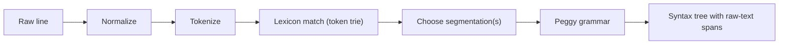

# @peas/parser

Ingredient-line parsers for Peas.

| Parser | Where | Status |
| --- | --- | --- |
| v1 | `src/v1/parser.peggy` | The live import parser. The queue uses it for every imported line. |
| v2 | `src/v2/` | New structural parser built in Phase 1. Fully tested from fixtures, not yet wired into imports (Phase 5). |
| Legacy | `legacy/` | Old grammar work kept for reference only. Nothing builds or imports it. |

Most of this README is about v2: how it thinks, what it produces, and how to try it.

## v2 in one minute

v2 splits the job of understanding an ingredient line into three layers, each with one responsibility:

1. **The grammar finds the shape.** It knows what amounts, ranges, units, packages, parentheses, commas, and "and"/"or" look like. It contains no food words at all.
2. **The lexicon names the words.** A list of known expressions, each with a role (`FOOD`, `ATTRIBUTE`, `PREPARATION`, `DEGREE`, `MEASUREMENT_MODIFIER`, `INSTRUCTION`). It is passed in at parse time, so teaching Peas a new word never means editing the grammar.
3. **The resolver decides meaning** (Phase 3, not built yet). It takes the syntax tree and decides which food is meant, whether "milk or cream" is one food or two, and so on.

Phase 1 delivered layers 1 and 2. Phase 2 added the shared schemas layer 3 will produce (see [Ontology, resolution, and review schemas](#ontology-resolution-and-review-schemas)) and the database tables that store them. Without a lexicon the grammar still parses every line; words it doesn't know are kept as `UNKNOWN` instead of being dropped or guessed.

## The pipeline



**1. Normalize.** Unicode fractions become plain ones (`½` to `1/2`), dashes and quotes are unified, and whitespace is collapsed. Normalization keeps an offset map, so every node in the final tree still points at the exact characters of the original line.

**2. Tokenize.** The normalized text is split into words, numbers, and single punctuation marks. `extra-virgin` becomes `extra | - | virgin`. The lexicon and the grammar both use these token boundaries, so they always agree on where a word starts and ends.

**3. Match the lexicon.** A token trie finds every run of tokens that spells a lexicon entry. Matching is token by token and ignores case, so "Kosher salt" matches the entry "kosher salt". Punctuation is a token too, so "all purpose flour" (no hyphen) does not match the entry "all-purpose flour"; spelling variants need their own entries. One line can produce overlapping matches: `garlic` and `garlic cloves` both match in "3 garlic cloves".

**4. Choose a segmentation.** Overlapping matches have to be resolved into one non-overlapping set.

- `CONSERVATIVE` mode (the default) uses only `ACTIVE` entries, prefers the longest match, and returns exactly one tree.
- `EXPLORATORY` mode also uses `PROPOSED` entries and returns several alternative trees (up to a limit). This is how a reviewer will see "what would change if we accepted this entry?"

**5. Run the grammar.** The Peggy grammar (`src/v2/grammar/ingredient-line.peggy`) reads the normalized text. It receives the chosen lexicon matches, the unit table, and the token boundaries through parse options, and consumes a lexicon match as a single item.

**6. Build the syntax tree.** The grammar output is converted into an `IngredientLineSyntax` (see `src/v2/ast/types.ts`, validated by the Zod schemas in `src/v2/ast/schemas.ts`). Offsets are mapped back to the raw line. Parsing never throws: a line is `PARSED`, `PARTIAL` (some text left over), or `FAILED` (raw text kept).

## What the tree contains

Each line becomes one or more **segments** (one ingredient mention each). A segment has:

| Field | Meaning | Example from "2 heaping cups all-purpose flour, sifted" |
| --- | --- | --- |
| `quantity` | How much, as an exact fraction | `EXACT 2 cup` |
| `measurementModifiers` | Words between the amount and the unit | `heaping` |
| `phrase` | The ingredient words | `all-purpose flour` |
| `parentheticals` | Text in parentheses, with its own quantity if it has one | (none) |
| `trailing` | Everything after the first comma | `sifted` |
| `coordination` | An unresolved "and"/"or" inside the phrase | (none) |

Quantities come in seven kinds:

| Kind | Example | Read as |
| --- | --- | --- |
| `EXACT` | "1 ½ tbsp." | 3/2 tbsp |
| `EXACT` (implied) | "pinch of salt" | (1) pinch |
| `RANGE` | "2 to 3 lbs" | 2-3 lb |
| `APPROXIMATE` | "about 1 cup" | ~1 cup |
| `PACKAGE` | "1 (14-ounce) can" | 1 can, each 14 oz |
| `ALTERNATIVE` | "1 tbsp or 15 ml" | 1 tbsp, or equivalently 15 ml |
| `SUM` | "1 cup plus 2 tablespoons" | 1 cup + 2 tbsp |
| `UNSPECIFIED` | "to taste" | TO_TASTE |

Amounts are stored as exact rationals (`{ numerator: 3, denominator: 2 }`), never floats, so "1/3 cup" stays exactly one third.

## Reading the summary notation

The examples below use the one-line summary from `describeSyntax`:

| Notation | Meaning |
| --- | --- |
| `[2 cup]` | Quantity |
| `<heaping>` | Measurement modifier |
| `{garlic cloves:FOOD}` | A lexicon match and its role |
| plain words | Words the lexicon doesn't know (`UNKNOWN`) |
| `(...)` | Parenthetical |
| `, sifted` | Trailing text after the comma |
| `;` | Boundary between two segments |
| `~` / `(1)` / `\|` / `+` | Approximate / implied / alternative / sum |

## Walkthrough: example lines

All examples use the small demo lexicon in `fixtures/lexicon/demo.json` unless noted. Run any of them yourself with `yarn workspace @peas/parser explain:line --lexicon demo "<line>"`.

### "2 cups flour" (no lexicon match)

```
Tokens      2 | cups | flour
Summary     [2 cup] flour
  quantity  EXACT 2 cup  ("2 cups")
  phrase    flour
```

The grammar sees a number followed by a unit, so `2 cups` is the quantity. "flour" isn't in the demo lexicon (only "all-purpose flour" is), so it is kept as an `UNKNOWN` word. The structure is still fully parsed; the resolver will later have to work out what "flour" means.

### "2 heaping cups all-purpose flour, sifted"

```
Lexicon     "heaping" -> MEASUREMENT_MODIFIER
            "all-purpose flour" -> FOOD
            "sifted" -> PREPARATION
Summary     [2 cup] <{heaping:MEASUREMENT_MODIFIER}> {all-purpose flour:FOOD} , {sifted:PREPARATION}
```

"heaping" sits between the amount and the unit. The grammar only accepts a word there if the lexicon says it is a `MEASUREMENT_MODIFIER`, which is why measurement modifiers live in the lexicon instead of in the grammar. The comma starts the trailing part, which holds the preparation note.

### "1 ½ tbsp. extra-virgin olive oil, divided"

```
Normalized  "1 1/2 tbsp. extra-virgin olive oil, divided"
Tokens      1 | 1 | / | 2 | tbsp | . | extra | - | virgin | olive | oil | , | divided
Lexicon     "extra-virgin olive oil" -> FOOD
            "olive oil" -> FOOD
            "divided" -> INSTRUCTION
Summary     [1 1/2 tbsp] {extra-virgin olive oil:FOOD} , {divided:INSTRUCTION}
```

Normalization turns `½` into `1/2`, and the grammar combines `1 1/2` into the rational 3/2. Both "extra-virgin olive oil" and "olive oil" match; conservative mode keeps the longer one. The quantity's span still reads `1 ½ tbsp.` from the raw line, not the normalized text.

### "3 large garlic cloves, finely minced"

```
Summary     [3] {large:ATTRIBUTE} {garlic cloves:FOOD} , {finely:DEGREE} {minced:PREPARATION}
```

There is no unit here: "cloves" comes after "garlic", so it is part of the food, and the lexicon names the whole expression "garlic cloves". "garlic" alone also matched, but conservative mode keeps the longer match. Compare "6 cloves garlic, minced", which parses as `[6 clove] {garlic:FOOD} , {minced:PREPARATION}`: when "cloves" directly follows the number, it is a count unit. Without a lexicon, the same line parses as `[3] large garlic cloves , finely minced` with every word `UNKNOWN`: same structure, no meaning yet.

### "1 (14-ounce) can diced tomatoes"

```
Summary     [1 (14 oz) can] {diced:PREPARATION} {tomatoes:FOOD}
  quantity  PACKAGE 1 (14 oz) can  ("1 (14-ounce) can")
```

A count, a parenthesized size, and a package unit together form a `PACKAGE` quantity: one can, each holding 14 ounces.

### "about 1 cup packed brown sugar"

```
Summary     [~1 cup] {packed:MEASUREMENT_MODIFIER} {brown sugar:FOOD}
```

"about" wraps the quantity as `APPROXIMATE`. "packed" comes after the unit, so it lands in the phrase rather than in `measurementModifiers`; the lexicon still tags it, and the resolver can treat it as describing the measurement.

### "1 cup plus 2 tablespoons unsalted butter, softened"

```
Summary     [1 cup + 2 tbsp] {unsalted:ATTRIBUTE} {butter:FOOD} , {softened:PREPARATION}
```

"plus" joins two measurements into a `SUM`. Unit spellings are canonicalized: "tablespoons" becomes `tbsp`.

### "1 tbsp or 15 ml olive oil"

```
Summary     [1 tbsp | 15 ml] {olive oil:FOOD}
```

"or" between two measurements is an `ALTERNATIVE` quantity: the same amount written two ways.

### "Kosher salt and freshly ground black pepper, to taste"

```
Summary     [TO_TASTE] {Kosher salt:FOOD} and {freshly ground:ATTRIBUTE} {black pepper:FOOD}
  coordination "and" (unconfirmed until the resolver decides)
```

"to taste" becomes an `UNSPECIFIED` quantity even though it comes at the end. The "and" inside the phrase is recorded as a coordination with `confirmed: false`. The grammar can't know whether "salt and pepper" is two ingredients or "macaroni and cheese" is one; that decision belongs to the resolver.

### "1 tbsp butter and 2 tbsp olive oil" (two segments)

```
Summary     [1 tbsp] {butter:FOOD} ; [2 tbsp] {olive oil:FOOD}
  Segment 0  "1 tbsp butter"
  Segment 1  "2 tbsp olive oil"
```

When "and" is followed by a new quantity, the grammar can tell it starts a second ingredient, so the line splits into two segments.

### "1 tbsp virgin olive oil" (exploratory mode)

```
yarn explain:line --lexicon demo --exploratory "1 tbsp virgin olive oil"

Segmentation 0: [1 tbsp] {virgin olive oil:FOOD}     <- uses the PROPOSED entry
Segmentation 1: [1 tbsp] virgin {olive oil:FOOD}     <- ACTIVE entries only
```

"virgin olive oil" is a `PROPOSED` entry in the demo lexicon. Conservative mode ignores it and returns only segmentation 1. Exploratory mode returns both, which is what the future "Teach Peas" review screen uses to preview the effect of accepting a proposal.

### Known limitation: "2 to 3 lbs boneless, skinless chicken thighs"

```
Summary     [2-3 lb] {boneless:ATTRIBUTE} , {skinless:ATTRIBUTE} {chicken thighs:FOOD}
```

The grammar treats the first comma as the start of the trailing part, so "skinless chicken thighs" ends up in `trailing`. The lexicon roles make the mistake detectable (the food is in the trailing part, and the phrase holds only an attribute), and the Phase 3 resolver is responsible for reading phrase and trailing together. Cases like this, and the five known failures in `fixtures/golden/structural.dev.json`, are tracked in `fixtures/reports/v1-vs-v2.md`.

## Using v2 in code

```ts
import { randomUUID } from "node:crypto";

import {
  IngredientLineSyntaxSchema,
  buildLexicon,
  describeSyntax,
  parseLine,
  parseLineBest,
} from "@peas/parser/v2";

const lexicon = buildLexicon({
  revision: 1,
  entries: [
    { id: randomUUID(), text: "garlic cloves", role: "FOOD" },
    { id: randomUUID(), text: "minced", role: "PREPARATION" },
  ],
});

const tree = parseLineBest("3 garlic cloves, minced", { lexicon });
describeSyntax(tree); // "[3] {garlic cloves:FOOD} , {minced:PREPARATION}"
IngredientLineSyntaxSchema.parse(tree); // the Zod schema accepts every parser result

const alternatives = parseLine("3 garlic cloves, minced", { lexicon, mode: "EXPLORATORY" });
```

Every result records `parserVersion` (grammar and tree shape), `normalizerVersion` (normalization output), and `lexiconRevision` (which lexicon it was parsed with), so stored parses can be compared or re-run when any of them changes.

Lexicon entry ids must be UUIDs (`crypto.randomUUID()` in code; the database generates UUIDv7). `buildLexicon` validates its input with `LexiconSnapshotSchema` and throws on a non-UUID or duplicate id. In the app, the lexicon comes from the database: `buildLexicon(await getLexiconSnapshot())` from `@peas/database`.

## Ontology, resolution, and review schemas

`@peas/parser/v2` is also the single home for the shapes that the database, queue, and web app exchange about food knowledge (decision D19). Everything here is pure TypeScript and Zod, with worked examples in the source comments.

| Module | What it defines | Example |
| --- | --- | --- |
| `ontology/types.ts` | Enum value lists mirrored by the Prisma schema: concept and entry statuses, term kinds, relationship types, classification kinds, value sources, resolution statuses, prep positions | `FOOD_RELATIONSHIP_TYPES` = IS_A, PART_OF, DERIVED_FROM, PROCESSED_FROM |
| `ontology/inheritance.ts` | Which classifications flow across which relationships (D15), and `effectiveClassifications` to compute them at read time | buttermilk DERIVED_FROM milk inherits ALLERGEN_MILK but not DAIRY |
| `ontology/vocabulary.ts` | The seeded attribute dimensions and preparation operations, plus degree, measurement-modifier, and instruction value keys | bone = bone_in / boneless; prep `mince`; degree `fine` |
| `resolve/schemas.ts` | `ResolutionSchema` (ranked candidates with attributes, preparations, modifiers, unresolved spans) and `MentionSyntaxSchema` (the segment plus line context stored on each mention) | "1 lb boneless chicken thighs" resolves to chicken thigh with bone=boneless |
| `knowledge/schemas.ts` | `DiscoveryPayloadSchema` (one variant per discovery type), `DecisionPayloadSchema` (one variant per decision type), `DecisionEffectsSchema` | `{ type: "UNKNOWN_FOOD_PHRASE", phrase: "calamansi juice", headToken: "juice" }` |
| `knowledge/priority.ts` | The review-queue priority formula (D18) | 7 notes and 9 mentions of an unknown phrase score about 11.3 |

How the pieces fit, using "1 lb boneless chicken thighs":

1. The parser produces the syntax tree: `[1 lb] {boneless:ATTRIBUTE} {chicken thighs:FOOD}`.
2. The resolver (Phase 3) turns it into a `Resolution`: candidate concept "chicken thigh" via the PLURAL entry "chicken thighs", with the asserted attribute bone=boneless.
3. The database stores one `IngredientMention` for the segment, with `syntax` (a `MentionSyntax`), `quantity`, and `resolution` validated by these schemas.
4. If something can't be resolved ("calamansi juice"), the resolver emits a discovery; a reviewer's choice is recorded as a `DecisionPayload` with its own lexicon revision.

## Resolving meaning

The parser says what each word *is* (a quantity, a FOOD lexeme, an unknown word). The resolver (`src/v2/resolve/`) decides what the segment *means*: which food concept, which attributes, which preparations, and how sure it is. It is pure: it reads a `ResolverSnapshot` (plain JSON from `loadResolverSnapshot()` in `@peas/database`, or built from fixtures in tests) and never touches the database.

```ts
import { buildResolverContext, processIngredientLine } from "@peas/parser/v2";

const context = buildResolverContext(snapshot); // lexicon + ontology view + scoring config
const { mentions } = processIngredientLine("1 lb boneless chicken thighs", context);
mentions[0].status; // "AUTO_RESOLVED"
mentions[0].resolution.candidates[0]; // concept chicken thigh, attribute bone=boneless, score 0.833
```

How a segment is read:

1. **Find the head.** The rightmost FOOD lexeme in the main phrase that points at a concept. No head means UNRESOLVED, with the unknown words recorded.
2. **Give every other lexeme a role.** One word can have several entries ("whole" is fat content and form; "crushed" is a preparation and a form). The resolver prefers, in order: an attribute that applies to the head, a preparation, a degree, a measurement modifier, an instruction, an attribute that does not apply, and finally an extra food. Attributes apply when the head, or an IS_A or PART_OF ancestor, has that attribute dimension.
3. **Bind degrees.** A degree ("finely", "loosely") attaches to the next preparation or measurement modifier; one with nothing to attach to counts as unexplained.
4. **Apply package rules.** Measured in cans or tins, a head with exactly one canned descendant resolves to it.
5. **Split and branch.** "and" between two foods splits the segment into parts (`partIndex` 0, 1, ...) unless the whole phrase is an entry ("macaroni and cheese"); "or" keeps alternatives as extra candidates.
6. **Score and decide.** The score (0 to 1) rewards explained words and longer head matches and penalizes unknown words and ambiguity; verified past choices for the same phrase add a small prior. AUTO_RESOLVED needs exactly one candidate, no unknown words in the main phrase, and nothing ambiguous; everything else with a head is NEEDS_REVIEW.

Each candidate carries `reasons` that explain the decision. Worked examples with the semantic fixture lexicon (`fixtures/lexicon/semantic-cases.json`):

| Line | Status | Concept and details | Reasons |
| --- | --- | --- | --- |
| 1 lb boneless chicken thighs | AUTO_RESOLVED (0.833) | chicken thigh; bone=boneless | `head:chicken thigh(2 tokens)`, `entry:PLURAL` |
| 1 cup finely chopped parsley | AUTO_RESOLVED (0.767) | parsley; chop with degree fine, before the head | `head:parsley(1 token)` |
| 2 (14 oz) cans tomatoes | AUTO_RESOLVED (0.767) | canned tomatoes (from tomato via the can) | `head:tomato(1 token)`, `entry:PLURAL`, `package:can->canned tomatoes` |
| 2 green apples | AUTO_RESOLVED (0.767) | apple; color=green ("green" could also mean unripe, but ripeness does not apply to apples) | `head:apple(1 token)`, `entry:PLURAL` |
| 1 cup whole milk, plus extra for serving | AUTO_RESOLVED (0.833) | whole milk (its own concept, not milk plus an attribute); "plus extra" and "serving" are notes | `head:whole milk(2 tokens)` |
| 2 cups organic milk | NEEDS_REVIEW (0.417) | milk; "organic" is unknown | `head:milk(1 token)`, `unknown:"organic"` |
| Salt and parsley, to taste | AUTO_RESOLVED, two parts | part 0 "Salt": salt; part 1 "parsley, to taste": parsley | `split_coordination` |
| 1 cup milk or salt | NEEDS_REVIEW | two candidates, milk first | `alternative:or` |
| 3 tablespoons calamansi juice | UNRESOLVED | none; unresolved "calamansi juice" | none |

Knowledge changes need no grammar change: add the entry "icing sugar" for powdered sugar to the snapshot and "2 tbsp icing sugar" resolves on the next context build.

`yarn evaluate:resolution` writes `fixtures/reports/resolution.md`: coverage by status, the most common unresolved phrases, entry text with several targets, semantic precision (15 of 15 today), and coverage and precision at score thresholds 0.5, 0.7, and 0.9. `yarn workspace @peas/database db:evaluate:resolution` writes the same report for the live database.

## Teaching Peas: discoveries and decisions

Phase 4 adds the pure half of the review loop to `src/v2/knowledge/` and `src/v2/preview/`. The database and the review screens build on these; nothing here touches a database.

| Function | What it does | Example |
| --- | --- | --- |
| `discover(result, context)` | Discoveries one processed line suggests: an unknown food phrase, unknown modifiers next to known words (with roles suggested by position and spelling), attributes with several or no applicable meanings, attribute-plus-food identity questions, and ambiguous heads | "2 cups organic milk" gives `UNKNOWN_MODIFIER organic`, suggested role ATTRIBUTE |
| `suggestRelationships(context, concepts, relationships)` | RELATIONSHIP_SUGGESTION for a concept whose name ends with another concept's name, unless they are already related | "smoked paprika" IS_A "paprika" |
| `applyDecisionToSnapshot(snapshot, payload)` | The resolver snapshot after a decision, mirroring the database effects, so a preview can resolve lines both ways | adding the alias "icing sugar" makes "2 tbsp icing sugar" resolve to powdered sugar |
| `decisionScope(payload)` | The phrases, concepts, and mentions a decision can affect, for prefiltering previews and reinterpretation | `{ phrases: ["scallion", "scallions"], conceptIds: [...] }` |
| `generatePlural(phrase)` | The PLURAL entry a phrase decision adds; null for mass nouns and phrases that already look plural | "cherry tomato" gives "cherry tomatoes"; "flour" gives null |
| `diffResolution(before, after, ...)` and `summarizeResolution` | How a decision changes one mention (newly resolved, concept or attribute change, ambiguity, lost resolution) in readable form | "unresolved: icing sugar" becomes "powdered sugar" |

Decision payloads are validated by `DecisionPayloadSchema`. Phase 4 added optional fields without changing stored payloads: `exclusive` on MAP_TO_CONCEPT (the phrase stops meaning anything else), `plural` and `attributeValueIds` on CREATE_CONCEPT, `modifierText` on CONCEPT_PLUS_ATTRIBUTE, `applicableConceptIds` on CLASSIFY_MODIFIER and ADD_ATTRIBUTE_VALUE, and `teachPhrase` on CORRECT_MENTION. IGNORE_TOKEN stores an INSTRUCTION entry with the value key `noise`, which the resolver counts as explained and leaves out of its result.

## Commands

All commands run from the repo root with `yarn workspace @peas/parser <command>`.

| Command | What it does |
| --- | --- |
| `explain:line "<line>"` | Explains one line step by step. Flags: `--lexicon none\|structural\|demo`, `--exploratory`, `--json` |
| `test:run` | Unit, golden, invariant, schema, ontology, and v1 baseline tests (regenerates the grammar first) |
| `test:coverage` | The same tests with the v2 coverage floor (see `docs/testing.md`) |
| `report:compare` | Compares v1 and v2 over the corpus and golden sets; writes `fixtures/reports/v1-vs-v2.md` |
| `preview:lexicon` | Before/after preview of a lexicon change across the corpus |
| `evaluate:resolution` | Resolution report over the corpus and golden inputs with the fixture snapshot (`--snapshot <path>` for any `ResolverSnapshot` JSON); writes `fixtures/reports/resolution.md` |
| `extract:descriptors` | Classifies the v1 descriptor list into suggested roles and targets; writes `fixtures/lexicon/v1-descriptors.candidates.json` |
| `corpus:baseline-v1` | Re-snapshots v1 output to `fixtures/baseline/v1.jsonl` |
| `build` | Builds v1 and v2 into `dist/` |

## Fixtures

| Path | Contents |
| --- | --- |
| `fixtures/corpus/lines.jsonl` | Distinct real ingredient lines exported from imported notes by `yarn workspace @peas/database export:lines`. Reset to empty on 12 November 2026 (the earlier 682-line export included instruction text the old HTML parser mistook for ingredients); refill it after a fresh import. |
| `fixtures/golden/structural.dev.json` | 182 hand-checked expected parses (5 marked as known failures) |
| `fixtures/golden/structural.holdout.json` | 41 held-out cases used only to measure, never to tune |
| `fixtures/golden/semantic.json` | Expected meanings (concept, attributes, preparations) for the 15 section-32 lines; the resolver must get all of them right |
| `fixtures/lexicon/structural.json` | Measurement modifiers the structural tests assume |
| `fixtures/lexicon/demo.json` | Tiny illustrative lexicon for docs and `explain:line` |
| `fixtures/lexicon/semantic-cases.json` | The lexicon and small ontology (concepts, relationships, applicability, concept attributes) `golden/semantic.json` assumes; resolver tests build their snapshot from it, and the database integration tests load it to prove every target interpretation can be stored |
| `fixtures/lexicon/snapshot.json` | That fixture as a `ResolverSnapshot`, regenerated by `evaluate:resolution` |
| `fixtures/lexicon/modifiers.seed.json` | 99 reviewed modifier entries (preparations, degrees, measurement modifiers, instructions, attributes) loaded by `db:seed:modifiers` |
| `fixtures/lexicon/v1-descriptors.candidates.json` | Every v1 descriptor with a suggested role and target, for reviewing what to add to the modifier seed next |
| `fixtures/baseline/v1.jsonl` | v1 output for every corpus line, for comparison |
| `fixtures/reports/v1-vs-v2.md` | Latest comparison report |
| `fixtures/reports/resolution.md` | Latest resolution report (fixture snapshot); `resolution.db.md` is the live-database version |

## Further reading

- [Ingredient ontology rebuild](../../docs/architecture/ingredient-ontology-rebuild.md): the overall plan, decisions, the ontology data model, and the Phase 1, 2, and 3 deliverables.
- [packages/database/README.md](../database/README.md): the ontology tables and repository functions.
- [legacy/README.md](legacy/README.md): what the reference-only grammars are.
